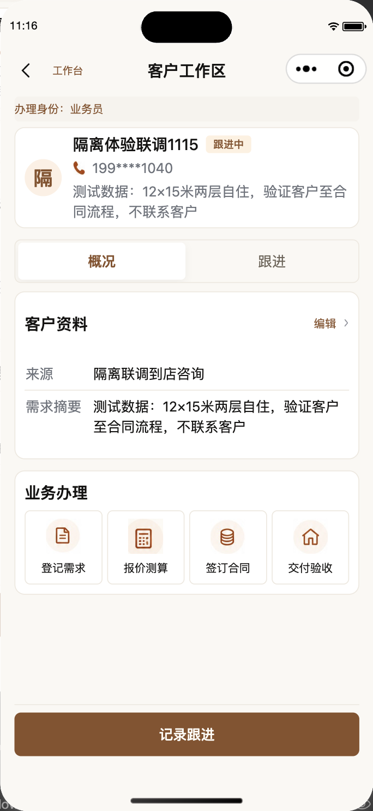

# 体验版源码修复与真实客户主链复验

## 代码基线与交付边界

本次在 `codex/fix-experience-catalog-20261115` 独立工作树修复源码，以当前体验版 `1.0.20261115.2` 对应的 `c13880d0` 为基线，合入户型修复，集成检查点为 `8f7c9158`。保留真机固定 B 公网、旧设备调试地址隔离及已有钱包/素材协议修复。没有重新上传开发版、设置体验版或部署后端。

11 月 15 日复核微信版本管理卡片：HiAi智能体名下 `1.0.20261030.3` 为开发版本，裴火荣名下 `1.0.20261115.2` 为体验版。本地代码通过不代表这两个外部版本已更新。

## 发现与最小修复

| 实际断点 | 修复 |
| --- | --- |
| 登记客资成功后回到首页，未沿后端 customerId 继续 | CREATED 进入对应客户工作区；LINKED 先确认该客户可读，读取失败只重试 GET，保留原幂等键和表单 |
| 需求、预算、合同入口没有真实客户，落入缺资料页面 | 交易视图先读取 CRM 客户；需求历史区分加载、成功、失败、无权限，错误可重试 |
| 客户页未初始化 saleWrite，业务员看不到办理入口 | 首次进入、详情加载和切岗均复用现有 PF.can；不增加岗位权限 |
| 迟到需求预填覆盖已输入内容；屋顶面积来源不可靠 | 用表单编辑代次保护人工输入；取消按面宽推算屋顶面积，人工核定后提交，服务端计价规则保持 |
| 客户姓名、手机号、需求摘要挤在一行 | 仅调整客户/需求/预算/合同头部换行布局 |
| 空内容、未知旧角色及禁止页标题传 undefined/null | 仅规范相应渲染空值，保留登录与岗位鉴权 |

异步回调沿现有会话代次、postId 和卸载状态守卫；不会用旧账号/旧岗位的结果导航或回填新页面。

## 开发者工具实测

使用微信官方 miniprogram-automator 打开未上传验证副本，合法域名校验保持开启。真实 `wx.login` 与 B 交换已绑定手机号的员工 145，再调用既有 afterRealLogin 完成会话保存，并点击业务员身份；没有模拟手机号授权弹层、注入管理员 token 或替换业务 API。下列记录来自真实页面控件和后端返回。

[六次业务写入回执](experience-customer-flow-20261115.json)：

| 顺序 | 业务动作 | 结果 |
| --- | --- | --- |
| 1 | 登记隔离测试客资 | customerId `2121799549299286017` |
| 2 | 保存首次跟进 | 关联同一 customerId |
| 3 | 登记 12×15m、两层需求 | requirementId `2121802662328492033` |
| 4 | 预算测算 | quoteId `2121802700861562882`；48,492,000 分，即 484,920 元 |
| 5 | 创建合同 | contractId `2121804604685508610`；WAIT_SIGN |
| 6 | 点击该合同的“签订合同” | SIGNED；随后独立 GET 回读 revision=2 |

上述写入均 HTTP 200、业务码 0。测试占地 180㎡、建筑面积 360㎡、屋顶面积 198㎡由表单人工填入；未登记真实收款、联系真实客户或发起收费任务。

最后的合同轮捕获 23 个请求，console error=0、异常事件=0，仍有微信全局组件按需注入的性能提示。早期 SDK 点击回执曾超时，实际写入已成功；先回读原记录，再从下一步续跑，没有重复登记客户/需求/预算。一个自动化头部控件选择器不可用，后续通过正常页面导航打开原客户继续，不能据此宣称该返回控件已通过验收。

## 检查与剩余验收

完整 `npm run check` 覆盖 60 个 WXML、185 个 JS、58 个 JSON、35 个注册页面；相关 profile 32/32、公司积分 7/7、接口集成 105/105 通过（岗位展示排序属于后续独立增量）。客户上下文专项 16/16，登记客资脚本覆盖 CREATED/LINKED/LINK_REQUIRED、权限/网络失败、切岗/换号、卸载及幂等重试。独立审查 P0/P1 为 0。

锁文件和依赖未变；既有扫描记录十三项工具链告警，见 [依赖扫描](public-catalog-security-scan-20261115.json)，没有通过自动升级扩大本次修复范围。新增代码与证据提交前扫描真实凭据。

本轮证明客户主链到合同签订成立；总部设计委托/上传/修改/交接、工程施工与费用/回款/双人复核、付费商城和真机支付均未因此完成验收。同一账号兼岗也不能替代双人复核场景。

## 回退

源码可按对应提交 git revert；未上传，所以没有微信版本回退动作。隔离 B 的测试单据留作后续联调，不通过删库回退；如需撤销，使用各业务正常作废流程，保留关联与审计记录。后端与 A 系统未变。
