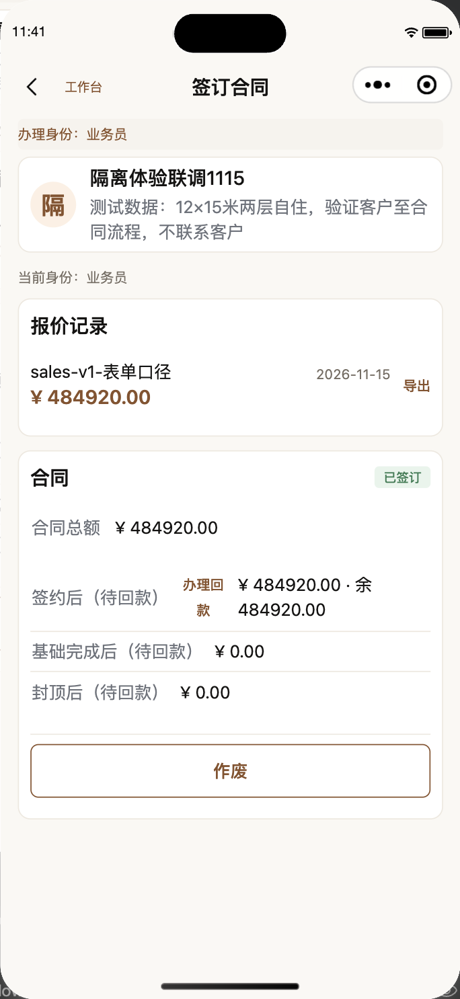
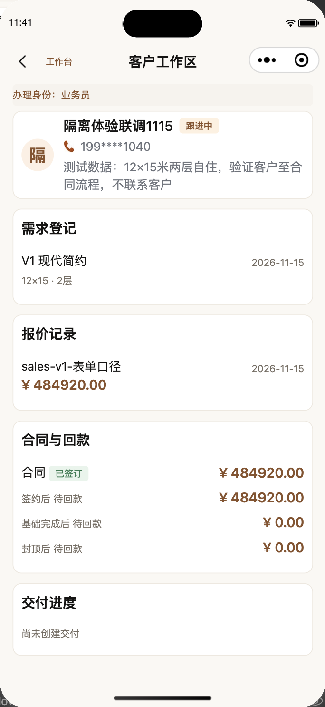
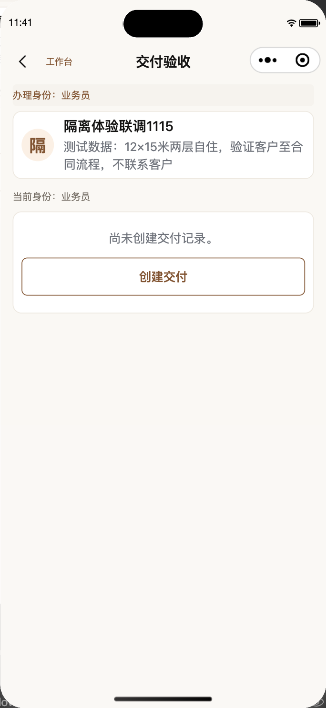

# 进度、交付与三期回款实际显示修复

## 实测发现与根因

客户合同已真实签订后，原生截图显示三期回款名称和金额为空，但接口和 JS 映射均有完整数据。原因是 WXML 顶部样式 WXS 模块名为 `st`，两处期次循环也用 `wx:for-item="st"`；原生表达式被模块名遮蔽。合同与进度页统一改用 `stageRow`，保留所有金额、余额、状态、data-stage-id 和既有收款条件。

直接打开 progress / delivery 时，交易接口虽返回签订合同和期次，页面仍显示“客户资料暂不可用”。两个加载器此前没有读取真实 CRM 客户，顶层 customer 门禁挡住整页。现均复用 `loadTradeCustomerContext`，沿各自已有 gen/sessionGen/postKey 读取 customers.get；接口失败显式显示、401/切岗/迟到响应沿原守卫处理。没有从合同拼造客户，也没有修改 API 或权限。

客户资料显示后又发现进度页合同与三期继承横向布局、客户头部文本越界。增加范围限定的纵向合同卡片，期次按行左右排；将已验证的头部换行规则扩展到 progress/delivery。API 没有旧阶段模型时不显示空的“当前阶段”卡，仍展示真实需求、报价、合同和交付数据。

## 开发者工具复验

[原生逐页请求与可见文本](experience-contract-stages-native-20261115.json)：2026-11-15 11:41（北京时间）使用已绑定账号真实 wx.login，点击业务员岗位，依次直接进入原客户的 contract / progress / delivery。请求观察器只记录结果，不替换 API；没有登记收款、创建交付或推进节点。

- 两处期次均实际显示：签约后 / 待回款 / 484920.00；基础完成后 / 待回款 / 0.00；封顶后 / 待回款 / 0.00。
- 两页均为原合同 `2121804604685508610`、状态 SIGNED，客户、需求和预算编号沿原链路。
- delivery 读到真实客户和原签订合同，并正确显示“尚未创建交付记录”。不存在的交付返回既有“未创建”业务码，属于当前前置状态，不认定为 API 缺失或已完成交付。
- 捕获 21 个请求，console error=0、异常事件=0；保留一条微信全局组件按需注入性能提示。没有 `/franchise/` 业务 POST。
- 早期自动化曾使用合同页 kv 选择器读取进度页 flex 行；随后实际发现进度页根本没有发起客户读取。补齐真实客户读取后，按各页实际 DOM 并等待客户就绪复验。失败轮和原截图保留在私有证据中，没有重复业务写入。

## 最终检查与交付边界

完整 `npm run check` 退出 0，接口集成 113/113；客户上下文专项 23/23，包含真实形态期次映射、progress/delivery 直接入口、客户读取失败及切岗迟到不回填。三期回款红测 16/17，进度/交付红测 19/23，修复后均通过。独立窄审 P0/P1/P2 为 0。

与未上传原生项目比对，720 个已跟踪小程序文件内容完全一致。静态核对本项目显式 WXS 模块与同文件循环变量，无剩余同名冲突。完整检查、已知依赖/孤儿脚本边界详见 [最终检查](experience-final-checks-20261115.json)。

本轮所有修复保存在 `codex/fix-experience-catalog-20261115`；[微信版本观测](wechat-versions-held-20261115.json)与上传动作分开留证，本次没有上传或替换开发版/体验版，也没有部署后端或修改 A。

这证明三期计划展示和交付空状态，不等同收款、工程施工、总部设计或付费商城的完整验收。下一阶段继续沿原客户/合同和隔离单据逐步推进，不用承载页通过代替业务闭环。

## 回退

本增量只有前端读取、模板、样式和回归用例，可 git revert；无新的业务单据或资金操作。此前按用户要求撤销的总部老板任职不随源码回退恢复。
