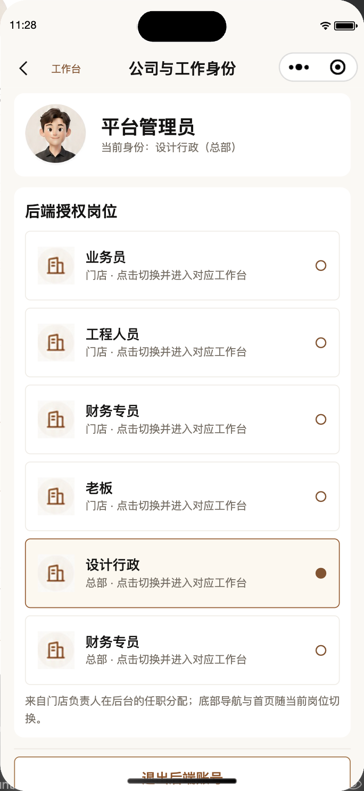

# 岗位顺序、老板任职与 Web 管理入口

## 本次结果

按用户给定顺序调整“公司与工作身份”页的授权岗位列表。真实微信登录重新拉取岗位后，开发者工具显示：

1. 业务员（门店）
2. 工程人员（门店）
3. 财务专员（门店）
4. 老板（门店）
5. 设计行政（总部）
6. 财务专员（总部）

当前账号没有独立的“总部行政”有效任职，因此没有凭空增加该入口。现有总部运营模板的启用和职责仍需业务定义确认；本次只为已有 `hq-operations` / `hq-operations-lead` 预设设计行政后、总部财务前的展示位置，不修改模板或启用状态，也不把总部运营宣称为已经实现的总部行政。

排序按 roleCode 和 orgType 作用于展示副本，不改后端返回数组、任职编号、默认当前岗位或权限。负责人版本属于相同条线，同组及未知岗位保留原相对顺序。点击选项仍用原 postId，不使用排序索引办理业务。

## 老板任职撤销实证

用户明确要求老板只保留门店老板。通过正常账号登录 B 后，先核对员工 145 的 7 个有效任职，再调用 `DELETE /platform/org/posts/2121619170781044738` 撤销总部老板。业务码 0；服务端回读剩余 6 个任职，只有该编号消失，门店老板及其余 5 个专业岗位均保留。

随后验证：已撤总部老板请求返回 `1103000002`；门店老板管理本店成员返回 0；门店老板跨组织读取总部成员返回 `1103000004`，没有因同一员工兼岗放开总部管理。详见 [任职与权限回执](post-order-and-revocation-20261115.json)。未直接改数据库，未重启服务，未修改 A。

## 发现并修复的资料显示问题

排序实测截图中，已真实登录的身份页仍显示本地“访客”姓名。原因是身份页不读 `/platform/profile/mine`。仅将既有资料读取扩展到 identity 的首次 `refresh(true)`，复用现有会话守卫、资料合并和缓存回填；普通 onShow 不重复请求，profile 原行为保留，learning 等其他页不增加请求。

[最终身份页原生回执](experience-identity-profile-native-20261115.json)证实资料 GET 成功并替换访客姓名；捕获 4 个请求，error=0、异常事件=0。测试账号后端姓名“平台管理员”是账号资料，卡片下方显示的实际办事身份仍是设计行政。

## Web 是否已有岗位职责设置

以下为当前后端工作树源码核对，尚未打开已部署 Web 实测菜单可见性，不能视作线上 Web 验收。

| 业务 | 源码已有入口 | 能力 |
| --- | --- | --- |
| 员工实际任职 | 组织管理 → 部门与员工 `/fr/org/staff` | 录入/恢复、追加岗位、撤销单岗、部门、离职交接、紧急撤权 |
| 当前办事身份 | 组织管理 → 工作身份 `/fr/identity` | 按已授权任职切换总部/门店 |
| 角色功能权限 | 系统设置 → 角色管理 `/system/role` | 菜单及数据权限 |
| 文字版岗位职责 | 未见专用编辑页 | 通用备注不能等同完整职责配置 |

任职页对应 `GET/POST /platform/org/staff`、`POST /platform/org/posts`、`DELETE /platform/org/posts/{postId}` 等真实 API；只能管理当前岗位所属组织。不要将菜单白名单外的通用 `/system/post` 当作小程序业务任职入口。

源码证据位于后端工作树 `平台程序/admin-ui/src/router/modules/fr.ts`、`views/fr/org-staff/index.vue`、`views/fr/identity/index.vue`、`views/system/role/index.vue`、`api/platform/staff.ts`；服务端 `StaffOrgAdminController` 和 `PostPermissionEvaluator` 分别校验组织范围与当前任职权限。

## 验证与版本边界

- [完整检查](experience-final-checks-20261115.json)：60 WXML、185 JS、58 JSON、35 个页面通过；profile 导航 32/32、公司积分 7/7、接口集成 106/106，资料专项、会话守卫 16/16、认证契约 54/54 通过。新排序脚本已接入总检查。
- 独立审查 P0/P1/P2 均为 0，范围为本次代码增量，不代表整个项目无缺陷。
- [综合原生复验](experience-final-native-20261115.json)：六岗真实顺序、同一已签合同回读、空内容渲染、集成后户型四封面和详情两图通过。23 个请求，error=0、异常事件=0；截图同时发现合同三期回款文字为空，另立增量修复，不能将合同签订回读等同财务展示通过。仍有一条微信全局组件按需注入性能提示。身份页资料增量另做上述四请求复验。
- 空内容的初次 SDK 标量读取判定失败；同页运行时对象读回确认 content 为 null，未因此再改业务代码。早期工具回执/选择器限制见 [客户链记录](experience-customer-fix-20261115.md)。
- [视觉判定](experience-visual-verdict-20261115.json)来自开发者工具实际截图人工比对；没有运行不存在的 visual-verdict skill，也不代替真机验收。
- 额外孤儿脚本巡检退出 1，存在 96 个既有孤儿脚本。按 Git 基线对照，前后名单一致、没有新增；本次排序测试已接入。依赖十三项既有告警见扫描记录；未修改锁文件或增加依赖。

客户主链源码修复已提交 `d64e8194`，本次排序/身份资料为后续独立提交。两者均建立在当前体验版基线上；本次没有上传、替换开发版或切换体验版。当前微信体验版仍为 `1.0.20261115.2`，因此还未包含这些本地修复。

总部设计、工程财务和付费商城全流程继续按原排查计划逐项验收，不能以岗位排序或客户签约成功代替通过。

## 回退

展示排序和资料读取可用 git revert 恢复，不影响授权集合。总部老板任职撤销属于用户明确要求的服务器数据操作，不随代码 revert 自动恢复；如以后需要恢复，必须由有总部管理权限的身份通过正常任职分配接口办理。本次保持其撤销，不执行恢复。
