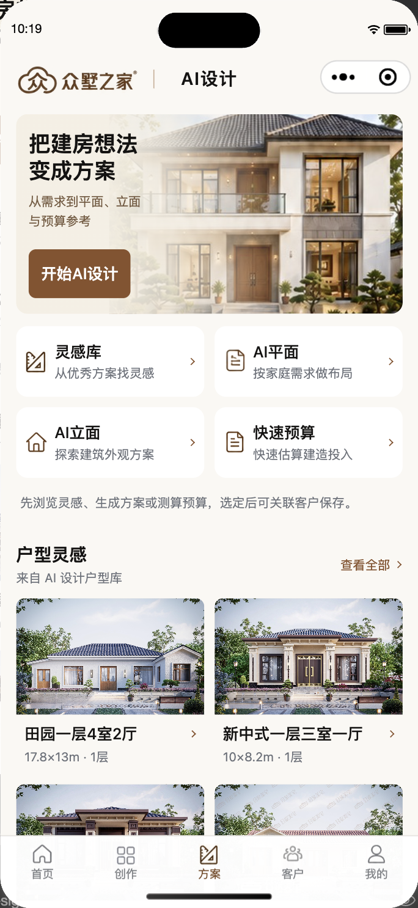
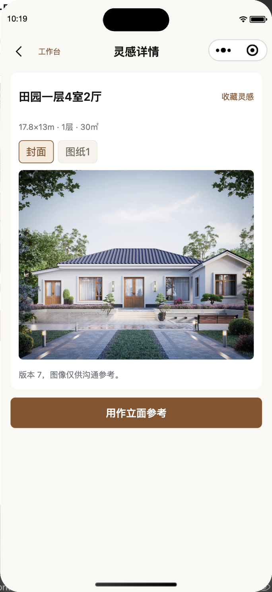

# 让赋能员工读取已有公开户型

日期：2026-11-15，Asia/Shanghai。目标：保留现有 AI 设计首页和四个入口，展示旧 AI 设计系统已发布的真实户型，通过 B 读取资料和图片。

## 实测原因

1. 原设计首页只有四个入口，没有案例请求和列表区域，所以截图下方为空。
2. 灵感库列表只渲染文字，没有加载封面；详情还把 A 公开案例资产送入 B 生成素材通道，同一真实资产返回业务 403。
3. 首屏案例和风格共用请求代次，首屏失败会被当作旧响应吞掉；快速切筛选时旧结果也可能覆盖新结果。

旧 AI 设计的数据源正常：携带其既有租户标识读取公开列表，返回真实案例。B 以业务员和总部设计行政读取同一批案例，均为 HTTP 200、业务码 0；风格筛选项为十条。两边前三个案例编号和标题一致，见 [岗位实测](public-catalog-role-probe-20261115.json)。老板访问设计能力返回 403 属现有三岗位能力门，本次不扩大岗位权限。

图片对照见 [图片通道实测](public-catalog-image-probe-20261115.json)：

- 正确：`POST /franchise/design/cases/{caseId}/assets/{assetId}/download-tickets`，业务码 0，得到的公开图片 HTTP 200、JPEG。
- 原错误路径：`POST /franchise/design/assets/{assetId}/download-tickets`，同一公开案例资产返回业务 403。

## 修复结果

首页在四入口下预览四个真实户型，卡片展示封面、标题和尺寸；“查看全部”进入灵感库，卡片直达对应详情。列表、详情均通过 B 的公开案例图片通道，不让小程序直接连 A。封面加载按批限制并发，签名 URL 仅留在当前页面；缺图、失败和重试清楚显示。

请求代次按风格、列表查询、列表封面和详情分开；筛选、换岗和卸载拒绝迟到数据，翻页或进入详情不会让首屏封面永久加载。筛选选项与传入 API 的风格/楼层值一致。直接详情读取 A 的 `parameters` 尺寸字段，并保留字符串编号；“用作立面参考”使用已验证详情，不依赖上一页列表缓存。

未修改 A 配置、数据、服务或 B 后端。本次没有触发 AI 生成、付费任务、合同或财务写入。

## 验证与边界

- 复现测试先失败再修复；新增两组行为测试接入 `npm run check`，最终 integration 49/49；完整检查退出码 0。
- 独立审查的两个 P1（分页封面卡住、直达详情参考按钮无动作）已修正并复审至 P0/P1 为 0。
- 官方开发者工具用真实 `wx.login` 与 B 交换已绑定手机号的账号，业务码 0、员工 145；复用现有登录完成处理，再实际点击业务员身份。没有伪造手机号授权、模拟 API 或注入管理员 token。此过程是已绑定账号的真实 API 登录复验，不冒充手机号授权弹层的自动化验收。
- [原生实测 JSON](public-catalog-native-20261115.json)：四个真实户型均有封面，详情两张图片已加载，引用成功写入立面表单；未创建生成任务。
- 原生复测没有 console error 或异常事件；两条既有 warn 分别为全局组件按需注入提示、身份切换时 `homeTitle` 收到 null。首次运行只记录到四条 error 计数，缺少消息正文，不能归因；关闭本任务独立验证窗口后重开采集，未再次出现。保留此观测边界，不宣称全项目控制台无问题。
- [扩展原生回归](public-catalog-native-extended-20261115.json)：灵感库首屏二十条资料及二十张封面均加载；输入 `17.8×13m` 后返回的二十条尺寸匹配案例均有封面。SDK 返回操作附近另捕获 `routeDone with a webviewId 10 is not found` 和一条无字符串正文的 error，没有异常事件，页面仍完成返回和检索。尚不能将其认定为产品或工具原因；后续需比较界面返回与 SDK 返回，并记录路由栈/生命周期，不能把扩展轮说成控制台全绿。
- [视觉核对](public-catalog-visual-verdict-20261115.json)：原四入口与品牌保留，真实封面和详情可见；无可用 visual-verdict skill，采用逐项截图对照。
- [依赖扫描](public-catalog-security-scan-20261115.json)发现锁文件既有十三项告警。本次未增加依赖、未改锁文件，未在此修复中升级或降级工具链；后续单独处理。
- 旧案例发布数据中，首个样例的 `17.8×13m / 1层` 与 `buildingArea=30` 有业务核对空间。本次如实映射来源参数，没有在 B 推算或改写 A 的原始资料。

准备更新版本 `1.0.1-dev1115`，仅开发版；上传成功与旧体验版保持的证据需在上传后另行回读。图库浏览通过不等于相册保存、付费 AI、客户或工程财务全链通过。

## 回退

代码与测试可通过对应提交的 `git revert` 撤回。小程序开发版本属于外部状态，需要以裴火荣身份重新上传指定旧完整业务包；不设置/取消 HiAi智能体的原体验版。公开图片票据到期自然失效，无业务单据或 A 数据回退。
