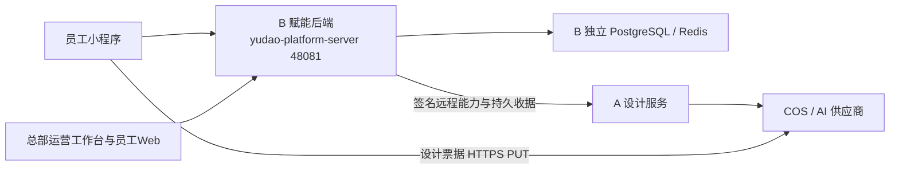

# 赋能平台三端上线联合审查报告

2026-11-14。结论：**暂不放行上线**。本轮已完成多代理联合审查、问题拆解、修复及本地独立验收，代码已提交到新分支；证据见09。容量、真实渠道、内容发布业务边界和角色真机仍有明确门禁；不能把本地测试称为生产完成。

## 唯一候选与新隔离工作区

用户确认的后台是截图中的“众墅之家赋能平台管理后台／总部运营工作台”，采用功能完整的 `platform-split`。员工 `/fr` 门户也在范围内，但不能代替总部后台。

| 范围 | 新工作树（相对各自仓库） | 新分支 | 基线 |
|---|---|---|---|
| 小程序 | `zhongshu-ai-platform-v3/.worktrees/joint-review-20261114` | `fix/joint-review-mini-isolated-20261114` | `b8b37f89` |
| Java／Web | `众墅之家AI赋能平台/.worktrees/joint-review-20261114` | `fix/joint-release-split-20261114` | `60e70cfb` |

两仓独立历史，不能因 origin 地址相同就互相覆盖。所有本轮修改均留在新树；原目录恢复原分支，保留他人修改。完整路径、SHA和最终提交见 `evidence/baseline.json` 与交付记录。

运行面以 `yudao-platform-server`、B默认端口48081、总部首页 `admin-ui/src/views/platform/home/index.vue` 为准。5174旧设计后台的早期视觉证据作废；5173属于既有split树，也不能代表修复结果。本轮新树已在独立5186端口核对品牌登录入口；尚未登录总部真实角色验收全部页面。

## 审查方法与覆盖

按 [NIST SSDF](https://csrc.nist.gov/pubs/sp/800/218/final) 的复核、测试和交付证据实践，并参考 [OWASP ASVS](https://asvs.owasp.org/) 的授权、会话、输入与配置要求。采用审查、失败复现、最小修复、行为回归、另一代理独立验收。此为有范围的软件评审，不是ASVS认证或完整渗透测试。

覆盖小程序页面及状态、前后端接口、组织岗位隔离、发布状态机、财务幂等、Redis并发、远程AI资源、数据库分页与聚合、依赖安全、独立制品和备份配置。前端、后端、依赖、总部专项分别审查；独立验收发现的错误契约和遗漏会回到开发，不以测试数量替代真实业务证据。

## 核对后的运行架构

总部运营数据从B本地事实读取；设计上传与生成跨B→A能力边界。只看B内容资产接口会误判设计上传协议，因此该链路已单独复核。数据库查询有分页与tenant条件，新增首页汇总在SQL端完成，避免浏览器循环拉200组织明细。AI准入保护按进程生效，多副本总配额仍要结合供应商合同验证。

## 已确认问题与处理

| ID | 级别 | 发现与影响 | 处理／剩余条件 |
|---|---|---|---|
| SCOPE-01 | P1 | 工作区及默认代理可能启动旧设计平台；干净Web无env时API基础地址无效 | 新隔离树、品牌文档、默认B代理48081、同源API默认值；启动行为测试与5186浏览器入口核对 |
| MINI-01 | P1 | 上传Promise变量越域；HTTP错误仍可能继续完成；PNG曾一律报JPEG | 原始字节PUT、完成状态检查、错误拒绝；生产设计真实票据来自B远调A的COS，第三轮PNG魔数及真实COS契约测试通过 |
| MINI-02 | P1 | 发布记录状态迁移顺序错误，切岗后仍可能写下一步 | publishing→verify→link，每步检查岗位/记录代次，原键重试；verify后切岗不link行为验收 |
| MINI-03 | P2 | release可以使用缓存的联调域名 | release/无法识别环境时忽略缓存覆盖，develop/trial保留联调能力 |
| MINI-04 | P1 | 老板/销售首页失败被零值掩盖，慢请求隐藏工作台 | 立即显示角色布局，按来源区分成功/未知/失败与重试，迟到结果丢弃 |
| WEB-01/02 | P1 | 短信登录成功但岗位加载失败需重登；切岗失败丢失已确认上下文 | 保留会话重试、401退出、失败恢复旧岗位并隔离迟到响应 |
| WEB-03 | P1 | 部门创建超时重试可重复写入 | 前端稳定幂等键，后端组织行锁＋事务＋命令日志，作用域为组织及操作者 |
| HQ-01 | P1 | 首页只取100钱包却显示平台总额，200组织时少算 | 新SQL全量汇总、全量Top10；200钱包及跨租户集成测试 |
| HQ-02 | P1 | 任一接口失败令所有指标显示0/无 | 独立状态、权限检查、错误重试、请求代次保护；成功数据正常展示 |
| HQ-03 | P1 | 套餐硬编码0；历史定价算成生效；最新100条冒充30日趋势 | 套餐真实total；active SQL分页；图表明确最近100条样本；异常卡改为API真实的“支付异常记录” |
| BE-01 | P1 | 财务写入接受缺失幂等键 | Controller及服务入口拒绝空/超长键，保留自然状态幂等作废；回放及落日志额外核对组织，跨组织同键拒绝 |
| BE-02 | P1 | 短信限额和验证码消费存在Redis竞争 | Lua原子占位、计数和消费；同号20并发只发送一次；保留失败防风暴间隔 |
| BE-03 | P2 | 退款大Long ID使用引用比较 | 数值相等比较及大ID回归 |
| BE-04 | P1 | 慢远程调用可占满服务线程 | 每进程16／每组织4的非阻塞门禁，命令写入前拒绝、异常释放、恢复同门禁；只是资源保护 |
| DEP-01 | 分级 | split Web基线7项，其中high3 | 最小兼容补丁后high/critical为0；仍有moderate2/low2，另案迁移及可达性评估见依赖报告 |

原主目录备份脚本缺陷、旧Web53条审计与缺少员工页面的结论不适用于最终split候选。split已有独立Compose、分页、备份manifest与权限控制；本轮部署脚本检查13项通过，未做真实数据恢复演练。

## 上线阻断与验收限制

1. 内容发布：当前API是人工发布后的回执登记。UI曾暴露未接通的定时入口，后端没有 scheduled→publishing 调度；账号仍含演示选项，不能当真实组织授权账号。首发手动边界已向用户单独询问，确认和收敛前不签此业务验收。
2. 容量：用户目标200组织、1000员工、200在线、100同时发起AI。100线程门禁测试接受16、明确拒绝84，仅证明有界保护；没有完成200在线混合HTTP长稳压测，也没有供应商100任务配额/完成率证据。
3. 真实渠道：微信、短信、COS、AI供应商和费用/失败重试未在同一候选上完整联调。生产A强制COS；local://在本地split无现成上传中继，不能用B内容资产的相对票据冒充设计本地上传成功。
4. 全角色Web／真机验收、备份恢复和实际部署制品核对未执行。本轮未推送、合并、部署、上传、提审或发布。

## 任务与证据

[整改任务及验收标准](02-整改任务与验收标准.md) 是逐项工作单；[容量方案](03-容量与上线验收方案.md) 是首发规模验收矩阵。独立报告保留原发现与驳回历史，最终结果以本报告、任务表和最终验收记录为准。测试日志与扫描JSON在 `evidence/`，模拟、容器集成、真实渠道分开标注。
