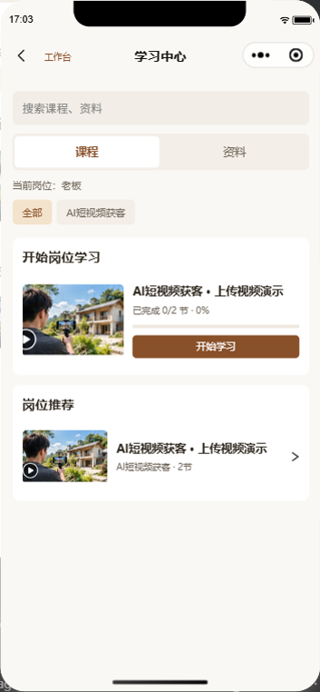
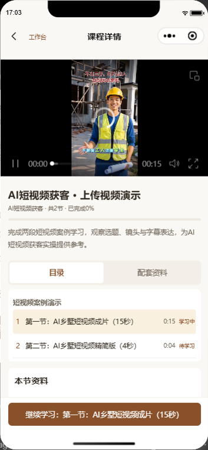
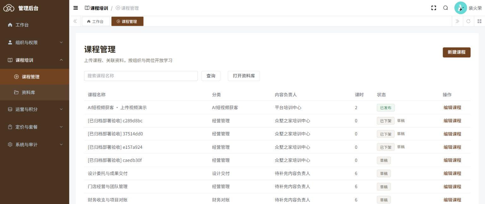

# 后台上传视频到小程序可见：生产修复与验收

日期：2026-11-16

## 结论

后端服务没有宕机，上传也没有丢失。生产数据中两条 MP4 已处理为 `READY`，但当时：

- 两份资料都没有被任何课程课时引用；
- 课程表中已发布课程数量为 `0`；
- 小程序按当前工作身份只读取“已发布课程版本中的课时和附件”。

因此资料库能显示上传结果，小程序学习中心不会直接暴露资料库中的孤立文件。本次已经按现有课程权限模型，把两条视频编入一门正式发布版本，再通过小程序原生页面验证课程、详情和视频播放器均可见。

## 已发布内容

| 项目 | 值 |
| --- | --- |
| 课程 | AI短视频获客 · 上传视频演示 |
| 课程 ID | `d4a6e4c1-7f0b-4c2a-9b6e-a1f7d0002026` |
| 发布版本 ID | `ea70a4e6-5634-49fa-8de5-1b73a50a2026` |
| 课程状态 | `PUBLISHED` |
| 可见范围 | 全部有效组织、全部 13 种有效岗位 |
| 课时 1 | AI乡墅短视频成片（15秒），版本 `60d7d58e-7a9c-4b00-b419-248b5a812e19` |
| 课时 2 | AI乡墅短视频精简版（4秒），版本 `d9593efa-dedc-42f3-914d-87277f7ce872` |

课程采用不可变发布快照。后续在后台编辑课程时，只有重新提交审核并发布，小程序才会切换到新版本。

## 生产验收

使用生产环境中一名有效员工会话及当前岗位验证：

1. `/training/app/courses` 返回该课程和 2 个课时；
2. `/training/app/courses/{id}` 返回两节 MP4 及正确时长；
3. 两节课时都能签发受控播放票据；
4. 两个媒体地址均以 Range 请求返回 `206`，读取 1024 字节，MIME 为 `video/mp4`；
5. 微信开发者工具原生页面显示课程列表、课程详情与视频播放器，页面无异常；
6. 管理后台前端测试 349 项通过、小程序完整检查通过；
7. 生产服务为 `active`，健康检查为 `UP`，修复完成后无应用级 `ERROR`。

管理后台课程管理页同时显示该课程为“已发布”，可继续进入编辑课程：

## 复现与证据

- `qa/training-visible-diagnosis-20261116/verify-published-video.log`
- `qa/training-visible-diagnosis-20261116/miniprogram-native-result.json`
- `qa/training-visible-diagnosis-20261116/publish-uploaded-videos.sql`
- `qa/training-visible-diagnosis-20261116/final-status.json`

执行日志不保存访问令牌、短期媒体票据或云存储密钥。

## 发布与回滚

发布操作先导出 `pf_training_course`、`pf_training_release`、`pf_training_audit` 三张表备份，再在单个数据库事务中写入课程、发布快照和三条审计记录。

如需撤回本次视频演示课程，可执行 [rollback-published-videos.sql](../../qa/training-visible-diagnosis-20261116/rollback-published-videos.sql)。脚本只把课程状态改为 `WITHDRAWN`，保留历史发布版本、媒体文件和审计记录。

## 仍需现场完成

微信开发者工具中的功能与播放器已通过。真机查看、播放、下载和微信正式审核发布仍需要用户扫码与提交审核。当前仓库的小程序开发版已经包含学习中心页面；如果手机打开的是尚未包含学习中心的旧正式版，需要先完成微信小程序审核发布。
