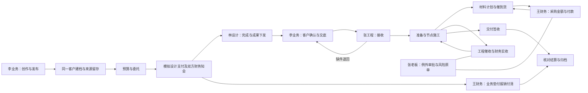

# 同客同项目六角色联调报告与修正方案

日期：2026-10-30。目标产品：众墅 AI 赋能平台 V3，AppID `wxe584f6fad7b54487`。

## 用户画像与验收尺度

按小型乡墅公司人员有限、经常兼岗、现场手机操作、以线下施工和收付款为事实来源的场景验收。组织人数没有硬编码限制。每次跳转检查：从哪项事实开始、谁办理、哪些字段必须输入、生成什么成果、下一位在哪看到、何时结束、出错如何回原单补救。正常约定自动生效；只有例外事项需要老板决定。业务、工程、财务、老板、总部设计行政、总部财务六名人员沿同一作品来源、同一 customerId/projectId 办理。供应商是应付往来对象，当前并无第七个供应商登录端。

## 证据边界

当前主要业务事实保存在微信本机 storage，创作、附件和支付存在明确模拟能力；现有跨设备服务为 `/sim/v1` 联调服务。本次体验版用于六角色流程体验，不能等同于真实多手机共享生产业务、真实生成媒体、银行支付或微信推送接入。每项结果分为代码检查、Node Page/WXML 事件、微信原生运行、官方上传、后台体验版设置；未执行的层级不写通过。

## 实施顺序与已发现问题

1. 重新生成业务与工程基础夹具，运行现行完整回归。新检出缺少历史夹具会中断；旧工程原生脚本仍按过期的合同审批、费用审批和直接归档规则验证。
2. 三条责任边界并行审计，先记录复现和最小方案，再改对应领域代码。见工程、财务老板、内容业务设计三份分报告。
3. 扩展现有工程 Page/WXML 验收接入内容业务产生的原客户原项目，禁止重建工程项目、换成默认样例或用隐藏账号完成主链。
4. 原生连续验收用独立项目，只由主代理运行。用同一条新业务结果接续工程，保存逐阶段状态及金额、来源、版本核对。
5. 汇总六角色导航遍历和原生跳转耗时，检查待办能够结束、返回原单合理。单案例耗时不能推断大数据或实体手机性能。
6. 合并已提交的上一批布局修改 `965ee3b`（本工作区 cherry-pick 为 `ae51a90`），完成回归、静态检查、漏洞和密钥扫描、diff自审与可回退验证；中文提交并推送，再官方上传和设置体验版。

## 当前执行状态

审计与修复已实施。已完成同客同项目的 Node Page/WXML 主链、微信原生业务10阶段与工程17阶段；完整20组回归和最终专项已通过。六角色原生终态回查7项也已通过，最终源码同步后复跑通过，原状态完整恢复。官方上传回执见后续发布记录，后台选为体验版仍受浏览器访问限制。

## 六角色同项目责任与成果

| 角色 | 本项目承担的操作 | 形成的成果 | 转给谁/如何结束 |
|---|---|---|---|
| 李业务 | 内容提取、二创、口播预览、保存作品、登记发布链接、咨询建客户、跟进预约到店、预算、委托、客户修改、成果确认、移交与补件 | 作品及发布ID、获客来源快照、客户ID、项目ID、预算版本、需求、客户确认与交底 | 林设计接办委托；张工程接收同版成果。接收成功关闭业务移交待办 |
| 林设计（总部设计行政） | 配置计价；登记线下设计完成；下发V1；收到修改后完成并下发V2 | 同项目正式成果、施工图、专业审核依据、版本历史 | 李业务确认和交底；实际设计生产在线下完成 |
| 张工程 | 接收/退回、准备、计划日期、开工、节点记录、材料计划、催到货、验收、催收、费用、交付、结算、归档 | 原工程档案、实际日期、材料数量/到货、催办承诺、验收/签收、结算记录 | 王财务登记款项；节点全部完成、合同款足额且签收结算后归档 |
| 王财务（门店） | 核对设计支付知会、分笔登记开工款/封顶款、补采购金额、材料及人工付款、业务垫付设计费报销、往来回查 | 原项目真实登记的实收/实付凭据、供应商应付余额、材料付款回写和业务报销结清 | 工程由到账/到货状态自动得到可办事项，不再二次核算制造重复待办 |
| 张老板 | 查看经营明细、应收风险、催收原单；处理确有必要的例外费用/政策事项 | 原单决策、负责人及风险可见性 | 标准合同/线内费用自动生效；老板复制话术不伪造已联系，催收由工程登记 |
| 罗财务（总部） | 查看一次性模拟设计费知会；历史分笔设计到账及总部代垫往来核对 | 总部本组织收款记录、原门店/项目关联、已核收和待核差额 | 满足当前设计下发条件后林设计可办；不重复核算门店的工程收款 |

新一次性设计费路径中，门店和总部财务接收自动生成的模拟支付知会，不额外要求双方手工再录同一笔款。历史首尾款及代垫路径单独验证双方登记和差额；这两条规则不能混为一条强制重复收款链。

## 逐项断点与详细修改

| 编号 | 原问题和实际影响 | 修改方案/实现 | 回归证据 |
|---|---|---|---|
| F01 | 接收页无法填写原因并退回，现场缺资料只能口头追业务 | 在原接收页恢复退回原因和按钮，保留原客户/项目/版本；六角色测试改成实际按钮 | B10：退回→原客户补件→重提→接收 |
| F02 | 内容咨询转客户写入中途失败会残留半截客资，重试被重复联系人卡住 | 对整段客资→客户→关联落盘保存前态，失败恢复客资、客户、管理责任三份状态，再允许重试 | 建档失败、最后落盘失败、重试唯一客户 |
| F03 | 材料逾期只有待到货，没有催办记录和承诺日期 | 直接在原材料计划登记已催和承诺日；承诺过期回待办，无承诺则次日再提醒，到齐自动结束 | 材料催到货9项，原生连续材料场景 |
| F04 | 老板应收明细只提供话术，找不到工程催收原单 | 增加同projectId/工程ID/期次的只读入口，显示责任工程和最新记录 | 老板真实点击、权限、复制不造记录、工程登记回写13项 |
| F05 | 总部材料代垫引用不存在的paidText，金额为空且把总部核收叫门店付款 | 使用receivedText/pendingText，分别展示总部已核收和待核 | ¥500已核收/¥300待核的真实WXML渲染 |
| F06 | 旧原生工程验收仍找已取消的合同审批/线内费用审批，交付又直接归档 | 更新为合同自动生效、线内费用直接应付、交付→结算→归档 | 原生脚本按最终代码连续运行，状态另列 |
| F07 | 业务和工程测试各跑一份样例，不能证明来源贯穿 | 工程脚本读取业务主链continuation，明确锁定原customerId/projectId、V2、来源和金额 | `check:single-project`，禁止隐藏账号接续主链 |
| F08 | 全量回归依赖本机旧qa目录，新检出无法复跑 | 显式生成当前业务/工程夹具；历史只读回归使用受控固定夹具 | 新工作区完整check:flow:all，结果另列 |
| F09 | 旧工程验收在归档结束，遗漏同项目的业务垫付设计费报销，容易误报全部财务闭环 | 验收接续原报销应付，登记并核实准确余额，检查原单已付清且财务待办消失 | 同项目报销12000元，无重建应付 |
| F10 | 行政隐私测试扫描整个JSON，普通revision或ID中的1390被误报为手机号 | 改为递归敏感字段与完整敏感值校验，保留真实泄露失败断言 | 误报反例、敏感反例、服务端连续10次通过 |
| F11 | 客户款已催但没有承诺日时永久等待，容易漏催 | 复用联系日，当天等待、次日仍欠款则重新提醒，保留现有一键登记 | 客户催收9项，足额到账后待办消失 |

## 使用效率与保留的业务规则

- 业务只输入一次客户基本资料；预算、委托、设计、工程沿用原项目，避免小公司反复建档。
- 工程在节点内组织现场、验收、材料及费用；材料同时显示数量到货和付款，两条事实不能互相替代。
- 开工款足额才能开工，封顶后产生第二期收款；真实财务凭据保持防重，取消它会带来重复记账风险。
- 工程人员填实际日期，计划日期可调整且保留历史。不会按默认工期冒充真实施工。
- 普通事项自动接续，只有异常金额/事项按现有政策交老板；不为5–20人团队增加采购部门或供应商账号。
- 催收/催货是记录真实联系结果，复制话术和打开页面都不改变状态。有承诺时到期仍未履约再提醒；无承诺时次日再提醒。
- 交付、结算、归档分别代表签收、账目核对和资料关闭，保留三步是为了避免“工程完了但款项没核对”；不增加第二套财务结清审批。
- 本轮发现的卡点首先是缺入口、状态不回写和旧测试规则。性能报告只给测得的运行时数据；无实体手机和大数据集证据时不承诺“完全不卡”。

## 前端覆盖解释

前端共34个注册路由，许多路由通过view切换子页面。本轮导航遍历包含六角色及游客访问边界，遍历深度4，记录实际派生入口和落地页面。零导航问题只表示这些可达状态中的页面没有缺失/拒绝/错误/静默跳错，不代表无限数据组合、每一种外部服务故障或所有实体机型均通过。具体数字与最终运行版本一同归档。

## 风险和后续独立门槛

1. 真实多手机协作：当前完整主链基于本机存储，跨端模拟服务只覆盖部分协作；需要正式后端后才可承诺六部手机同时接续真实项目。本轮不把接入正式后端扩展成未经设计的大规模改造。
2. 外部能力：数字人生成、内容发布、回采、设计支付、专业设计生产和微信消息存在模拟/线下边界，体验页应保留相应说明。
3. 供应商往来：内部的材料计划→应付→付款→原计划回写可验收，供应商本人收到资金、对账确认仍在线下，不虚构一个已完成的供应商端。
4. 开发依赖：`npm audit` 检出既有12项开发依赖风险（低1、中6、高2、严重3），生产依赖审计为0；本轮未新增/升级依赖，不能将其表述为全仓无漏洞。
5. 后台体验版设置：2026-10-30浏览器工具拒绝访问当前浏览器URL，不能用换工具绕过该拒绝。官方CLI上传与后台选为体验版分别记录，未选成功前不写“体验版已更新”。

### 现行业务边界纠正

核对提交 `83a3ad0` 后确认：老板已决定尾段为交付→结算→归档，并删除保修全部入口；旧 warranty 链接转结算。早期报告和原生测试仍写保修属于陈旧口径，本轮已纠正报告和原生回归，不把已取消的功能重新加入小公司流程。

## 工程逐项起点、终点与异常回路

| 子链 | 起点 | 关键跳转与下一责任人 | 结束条件 | 小团队适用性与补救 |
|---|---|---|---|---|
| 接收 | 业务确认V2成果并交底 | 指定工程看到原项目待接收；不完整则原页填写原因退回 | 工程接收，业务移交待办关闭 | 不复制项目，不增加部门流转；补件仍回原客户 |
| 进度 | 接收后开工准备 | 手填各节点计划日期→开工款足额→实际开工→逐节点现场和验收 | 全节点完成，保留实际日期与记录 | 计划和实际分开；工期调整在原项目留痕 |
| 材料计划 | 当前节点需要材料 | 工程多行计划→财务补供应方与采购金额→原应付付款 | 计划各项到齐且对应金额付清 | 支持分批到货、先货后款、先款后货，避免强制串行造成停工 |
| 催材料 | 需到场日期已过且有余量 | 原计划登记联系结果和可选承诺→等待→承诺逾期再回待办 | 实际到齐后退出催办，历史保留 | 一项原单处理，联系人说法可追溯；重复同文不造两条 |
| 催客户款 | 应收期次到期未足额 | 工程记录联系→老板从应收直达同一期原单→财务实际收款 | 该期款足额后待办关闭 | 复制话术不算已联系；允许分笔到账，不重复核算 |
| 用款及费用 | 当前节点计划用款/实际人工费用 | 工程登记→标准线内自动授权→财务按原应付付款 | 付款核实，原节点成本可回查 | 老板只承担例外审批；少一道纯形式确认 |
| 供应商财务 | 原材料采购数量与价格已明确 | 门店财务录真实凭据、付款→计划已付状态回写 | 应付余额0，原供应方与凭据可查 | 供应商实际到账确认在线下；不冒充系统已有供应商端 |
| 总部财务 | 同项目设计费支付或代垫往来 | 新模拟支付自动知会；历史收款登记/总部已核收与待核分开 | 符合下发条件或往来差额结清 | 不把门店工程收入重新记成总部收入 |
| 收尾 | 全部节点完成且合同款收齐 | 交付签收→结算核对→归档；财务接续业务垫付报销 | 工程已归档，报销和材料人工应付付清 | 工程归档不替代财务付款；本次用终态对账一起验收 |

本轮没有增加部门、审批层级、供应商账号或新依赖。修正集中在原单补入口、原状态回写和验收覆盖，沿用现有两期工程收款和例外审批规则。

## 验证明细与可复跑入口

| 验证层级 | 命令/结果文件 | 本轮结果 |
|---|---|---|
| 六角色同项目页面事件 | `npm run check:single-project` | 创作至V2移交10阶段、工程13项/40次按钮操作、报销12000元付清、六角色来源和成果断言通过 |
| 修复专项 | `npm run check:project-linkage` | 三库回滚2组、材料催办9项、总部代垫金额3项、老板催收关联13项通过 |
| 催收与小团队规则 | `npm run check:mgmt-batch-a` | 客户催收9项、材料催办9项、入口及自动生效规则通过 |
| 工程保护 | `verify-engineering-records-guards.cjs`、`verify-engineering-record-corrections.cjs` | 权限、数量/金额、分笔、撤回、更正、已交付保护通过 |
| 现行财务表单 | `prepare-finance-menu-fixtures.cjs`、`verify-finance-submit-pages.cjs` | 隔离目录生成；到账自动生效、线内费用实际支付、旧薪酬转绩效任务3项通过 |
| 全量 | `npm run check:flow:all` | 20组通过；包含导航遍历、管理完整流程、设计协作、包和生产依赖审计 |
| 上一任务布局 | `npm run check:layout:system` | 字体、间距、控件、长文案、共享页面布局约束通过 |
| 微信原生连续主链 | `native-business/results.json`、`native-engineering/continuous-results.json` | 同一customer/project，业务10阶段136次事件、工程17阶段386次事件；非实体手机 |

完整回归通过后，对最终补充的三库回滚、无承诺次日再提醒及同项目主链再次做了专项验证。原生工程验收在修正过期的测试选择器/断言后，从已保存的同项目检查点续跑，未换成另一份工程样例；事件数包含重试操作，不代表一段无中断录像。最后两处失败回滚/次日提醒边界以Node测试验证，上传前同步最终源码。

微信原生工程终态：客户 `customer-from-lead-1793294766601-qhq8r2`，项目 `project-from-lead-1793294766601-qhq8r2`；正式成果V2、13个节点全部完成；合同100000元、3笔工程收款合计100000元；2份材料计划；交付、结算、归档均完成；业务垫付设计费报销12000元已核实付款。

### 导航遍历与卡顿判断

| 身份 | 页面状态 | 点击 | 跳转边 | 导航问题 |
|---|---:|---:|---:|---:|
| 业务 |106|368|172|0|
| 老板 |185|658|359|0|
| 门店财务 |65|245|121|0|
| 工程 |49|198|103|0|
| 总部设计 |24|96|32|0|
| 总部财务 |35|154|67|0|
| 游客边界 |23|67|28|0|

以上为不同角色和view组合的可达页面状态，不是487个独立路由。原生业务39次程序导航，观测P50约1500ms、P95约1537ms、最大1651ms，包含脚本固定等待，不能解释为纯页面响应时间。未发现本次连续主链中的白屏、卡死或跳错原单；登录换岗及部分需滚动表单的完整操作仍耗时。本轮通过原单入口、自动生效、承诺再提醒减少反复找页面；实际设备性能与大量历史数据没有压测证据。

### 代码变更与简化

- `growth.js`：客资→客户→管理责任三库失败回滚，复用现有存储键。
- `engineering-records.js`及工程原单页：材料联系记录、承诺提醒、无承诺次日再提醒；客户催收使用相同提醒节奏。
- 委托旅程：复用已有领域退回动作补上页面入口。
- 老板和总部财务页面：链接原催收记录；正确展示总部已核收与待核。
- 验收脚本：接续同一项目、移除已取消的审批/保修/薪酬结算期待、显式准备缺失夹具；未新增业务抽象或依赖。

仓库没有独立TypeScript/ESLint配置，本轮采用项目自带 `check` 的JS/WXML/JSON/资源校验、变更脚本 `node --check` 与 `git diff --check`。安全扫描覆盖变更文本及解压后的固定夹具，未检出私钥或令牌；生产依赖0漏洞。开发依赖风险见上方风险清单。

六角色原生终态证据：`qa/six-role-project-20261030/native-roles/results.json`，7项通过、7张截图、运行时异常0、10个原存储键恢复一致。原生老板页面核对工程实收100000元、已核实实付17500元（材料4500元、人工1000元、业务报销12000元）；模拟设计费知会不重复计入实际收支。最终变更反向补丁检查通过，无数据库迁移。
