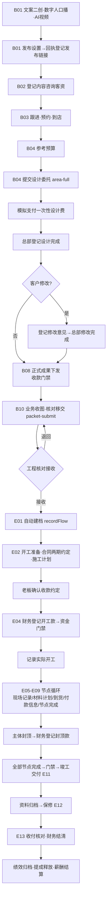

# 小程序前端全链路业务逻辑梳理（内容获客 → 工程交付 → 经营管理）

2026年10月28日。基于分支 `docs/miniapp-business-flow-20261028` 全量代码走读（承接 `feat/engineering-site-flow-20261028` 最新 5 个提交），覆盖 `miniprogram/` 全部 **33 个注册页面**（主包 6 页 + 10 个分包 27 页）、约 70 个 utils 业务模块与全部本地账簿。本文回答一个问题：**一个客户从刷到短视频，到最后房子交付、公司结账发提成，前端页面如何一步步承接**。

- 角色与导航体系依据：`utils/organization.js`、`utils/authority-v2.js`、`custom-tab-bar/`
- 全链业务口径依据：`docs/六角色全流程验收清单_20261023.md`（B/D/E/C/M/G 编号）、`docs/工程模块主链路业务逻辑梳理_20261028.md`、`docs/财务绩效模块业务逻辑分析_20261028.md`
- 所有结论以当前代码为准；文末第十三节给出 33 页面逐一归属清单，第十四节列出演示边界与已定稿未实施的重构方向。

---

## 一、总览：一条主线，六段旅程

全平台是**加盟商门店（乡墅建造公司）的一条订单履约流水线**，总部（众墅之家）作为设计服务供应商与供应链方参与其中。前端按角色切成六个业务域，前后以数据键（customerId / projectId）贯穿：

```
【获客】 内容创作与发布          sales     creation / studio / ai-video / growth
   ↓ 作品发布 → 登记咨询客资
【售前】 线索跟进与客户经营      sales     customers / growth / workflow(customer)
   ↓ 跟进预约到店 → 需求明确
【方案】 AI方案设计与预算        sales     design / workflow(方案视图) / explore / quote-export
   ↓ 参考预算完成 → 发起委托
【成交】 委托设计与设计付款      sales/总部设计行政/财务   workflow/commission
   ↓ 一次付清(新链路)→设计完成→成果下发→收图移交
【履约】 工程建设：进度/材料/工程款  engineer/PM/财务/老板  engineering / build×5
   ↓ 接收建档→开工准备→门禁→节点循环→交付归档
【经营】 财务账簿 / 绩效薪酬 / 老板工作台  finance/boss  management / admin×10
```

主链一图（与验收清单 B01–B10、E01–E13 编号对应）：



**数据底座**：当前全部数据存本地 `wx.storage`，核心账簿 4 本——`zhongshu-business-v3`（客户）、`zhongshu-engineering-v1`（工程）、`zhongshu-management-v1`（组织/财务/绩效，多公司 `books[companyId]`）、`zhongshu-growth-v1`（内容与线索）；会话在 `zhongshu-account-v1`。金额口径：业务设计费按**元**、工程合同与收付款按**分**存储，展示层显式换算。真实后端访问层（`api/` 目录，token 存 `zs-api-token-v1`）已建骨架（提交 `0fd622e`），登录与业务页面尚未切换。

---

## 二、角色、组织与导航（谁能看到什么）

### 2.1 十一个角色与六个演示账号

定义于 `utils/organization.js:1`，分属两种组织模板：

| 角色 | 中文名 | 组织 | 说明 |
| --- | --- | --- | --- |
| `boss` | 老板 | 门店+总部 | 审批、经营、绩效、交接 |
| `owner` | 门店负责人 | 门店 | 与 boss 同权（`isBoss` 含两者） |
| `sales` | 业务员 | 门店 | 创作、获客、跟进、委托、移交 |
| `sales-lead` | 业务负责人 | 门店 | 继承 sales + 团队 + 转交 + 审核 |
| `engineer` | 工程人员 | 门店 | 施工记录、材料到货 |
| `project-manager` | 工程负责人 | 门店 | 继承 engineer + 独立验收 + 接收 |
| `finance` | 财务专员 | 门店+总部 | 收付款登记 |
| `finance-lead` | 财务负责人 | 门店+总部 | 继承 finance + 核算/复核 |
| `hq-design-admin` | 总部设计行政 | 总部 | 登记设计完成、下发成果、面积计价 |
| `hq-operations(-lead)` | 运营 | 总部 | **已定义未启用**（`enabled()` 禁用） |

登录当前唯一入口是演示账号（`utils/demo-users.js:4`，登录页 `/pages/account/index?view=login`），固定 6 人：李业务 `sales-dual`、张工程 `engineering-dual`、王财务 `finance-dual`、张老板 `boss`、林设计 `hq-design-admin`、罗财务 `hq-finance-dual`。真实微信登录（`api/auth.js`，M2.7）已封装未接。同人多岗（如 sales-dual 兼 sales+sales-lead）可在「我的→工作身份」切换，人员 ID 不变；兼岗审核由 `utils/same-person-routing.js` 自动化（见 §9.4）。

### 2.2 角色 → 底部导航映射（`organization.js:6-20`）

自定义 tabBar（`custom-tab-bar/` + `utils/workbench-nav.js`）按登录角色完全替换：

| 角色 | 底部 Tab（页面路径） |
| --- | --- |
| 游客 | 首页 home / 业务 business / 工程 engineering / 管理 management / 我的 profile（五 Tab 营销预览） |
| 岗位停用 | 仅「我的」 |
| **boss / owner** | 首页 `admin/home` / 经营 `admin/finance` / 绩效 `admin/performance` / 我的 `admin/profile` |
| **sales / sales-lead** | 首页 `business` / 创作 `creation` / 方案 `design` / 客户 `customers` / 我的→`account/sales` |
| **engineer / project-manager** | 首页 `build/home` / 项目 `build/projects` / 材料 `build/materials` / 我的 `profile` |
| **finance / finance-lead** | 首页 `management` / 收支 `finance-desk?view=flows` / 项目(门店)或加盟商(总部) / 我的 |
| **hq-design-admin** | 首页 `workflow/commission?view=admin` / 项目 `…?view=projects` / 我的 |

Tab 文案随身份微调：总部非老板登录时「业务」显示为「设计」，财务岗「管理」显示为「财务」。

### 2.3 权限三层机制

1. **组织字典**（`organization.js`）：角色合法性、继承（`has()`）、落地页、导航。
2. **对象/操作权限总控**（`utils/authority-v2.js`，`access.js` 为转发层）：
   - `customer(p)`：hq-design-admin 只见总部设计单；boss 全见；sales 本人+协作；工程按移交关联。
   - `project(p)`、`rowAccess(r)`（财务行级）、`admin(view)`（管理端约 40 个视图 × 五类角色矩阵：审批类仅 boss、复核类仅 finance-lead、登记类为 finance 系）、`workflow(view,p,write)`。
   - 统一上下文 `context()` 派生 `orgType/staffId/active`，所有页面守卫共用。
3. **协作授权**（`utils/task-access.js`）：跨岗位按任务粒度授权（sales→follow；engineer→site/receive/reship 等），带有效期与字段白名单；无写权限时 `utils/page-visibility.js` 把表单页降级为只读。

**多租户**：演示环境两组织——湖北加盟商 `quanzhou`（store）与众墅之家 `headquarters`。组织账簿按公司分册；所有可见性判定都过 `sameCompany`；总部↔门店资金往来走 `utils/transfers-v2.js`（门店付款与总部到账是两个独立事实）。

**游客态**：五个 Tab 均为静态预览（`pages/engineering/guest-preview.js`、`utils/management-guest.js` 等，明确不读真实账簿），任何办理动作引导登录；`LOGIN_ONLY` 视图（profile/messages/performance）点击强制过登录页。

---

## 三、获客前端：内容创作到发布（B01）

### 3.1 页面与角色

全部归 **sales / sales-lead**（`utils/studio.js:63` guard），游客不可见：

| 页面 | 功能 |
| --- | --- |
| `pages/creation/index`（分包 creation-workflow） | 创作中心：链接提取文案 / 手动写文案 / 三模式入口 / 最近创作 / 工具四宫格 |
| `pages/studio/index`（分包 studio-workflow） | 工作台，**单页 12 视图**（view 参数驱动）：remix 文案二创 / digital 数字人口播 / tasks 任务中心 / result 视频结果 / publish 发布设置 / receipt 登记发布链接 / records 发布记录 / detail 发布详情 / works 我的作品 / recent 全部创作 / library 素材库 |
| `pages/ai-video/index`（分包 ai-video-workflow） | AI 视频：文/图生视频 + 参考生视频，草稿自动保存 |
| `pages/growth/index`（分包 growth-workflow） | 内容与客资：home 列表 / content 内容详情 / capture 登记客资 / lead 线索跟进（§4） |

业务 Tab（`pages/business/index`）是创作域的驱动首页：统计卡（今日待跟进/预约到店/本月委托）+ 快捷入口 + **「待我办理」待办板**（全部/客户/创作/款项四组，`utils/sales-todos.js`：视频生成完待保存→`studio?view=result`、成品待发布→`publish`、待登记发布链接→`receipt`、已发布内容→`growth?view=content`）+ 最近办理。

### 3.2 创作三模式（`utils/creation-demo.js`、`utils/studio.js`）

1. **爆款二创（文案）**：粘贴外链或选 3 个内置样本 →「提取文案」→ 二创设置（IP 人设 picker/自定义身份 + 补充要求）→「生成二创」（本地模板改写，保留最近 20 版）→ 可「AI 优化」（口语自然/重点清晰/精简表达）。
2. **数字人口播（视频）**：二创文案 → 选出镜人物/声音 →「创建口播任务」（明确弹窗"数字人生成服务暂未开通，创建预览任务"）→ 任务中心 → 标记完成 → 保存作品。
3. **AI 视频**：画面描述（可 AI 生成提示词）+ 首尾帧/参考素材 + 分辨率/时长/比例 →「创建任务」。

产物与状态按身份分域存储（`zhongshu-studio:{companyId}:{userId}` 等），切身份自动隔离；页面 onHide 持久化全部草稿。

### 3.3 发布流程（回执登记制）

发布目标是**外部平台（抖音/视频号）**，平台内无内容信息流；"发布"= 系统登记 + 人工外部发布 + 回填链接：

```
任务 generating ──标记完成──▶ completed ──保存作品 saveWork──▶ 作品（works）
作品 ──publish 视图：选发布账号(须组织授权)/标题/文案/话题/立即或定时──▶ 发布记录
  立即: publishing[待登记链接]   定时(≥1min): scheduled[待发布]
publishing/scheduled ──receipt 视图：粘贴真实作品链接──▶ published[已发布]
（演示态另有 verify[待核实]、failed[账号授权失效→换账号重发]）
published ──detail 视图「登记咨询客资」──▶ growth?view=capture（进入 §4）
```

内容治理（`utils/growth.js`）当前为 `direct-v1` 直发流（待发布→发布中→演示已发布），历史审核流（待审核/退回修改）保留为预留；发布包带签名，已提交记录不可覆盖，需新建作品。

---

## 四、客户经营：咨询、跟进与线索转化（B02–B03）

### 4.1 线索三通道与状态机

| 通道 | 入口 | 机制 |
| --- | --- | --- |
| **内容咨询**（主通道） | 发布详情/内容详情「登记咨询客资」→ `growth?view=capture` | 关联 contentId，来源=内容咨询，固化 `sourceSnapshot`（作品标题/平台/账号/链接） |
| 手动录入 | 客户列表「＋登记客户」→ `workflow?view=customers&modal=register` | 称呼+11位手机号+来源枚举（视频号咨询/抖音咨询/朋友介绍/到店咨询/其他），同门店查重 |
| 重复咨询 | 同手机号再次登记 | 关联原客户不重复建档（link-existing 保留原负责人） |

线索状态机（`zhongshu-growth-v1` leads，`utils/growth.js:60`）：

```
登记 capture(跟进中) ──follow──▶ 跟进中（可多次）
  ├─ convert / 直接建客户 ──▶ 已转客户（business.fromLead 建档，继承获客快照与跟进）
  ├─ request-link ──▶ 待负责人关联（同手机号原客户需负责人确认）
  └─ invalid ──▶ 无效（须原因）
```

### 4.2 客户档案与七阶段旅程（`utils/business.js`）

客户页 `pages/customers/index`（sales 专属 Tab）：四筛选（今日待跟进/预约到店/全部/已到店）+ 搜索 + 拨号 + 写跟进。客户工作区 `pages/workflow/index?view=customer&id=`（三子 Tab 概况/跟进/项目进度）承载全部客户操作：登记/编辑客户、记录跟进（方式：电话/微信/到店；结果；下次安排与时间）、编辑需求、方案预算（§5）、委托入口、任务授权、责任转交。

- **展示状态**：已登记 →（非到店跟进）跟进中 →（到店跟进）已到店。
- **旅程 7 阶段**（`STAGES`）：客户跟进 → 需求沟通 → 设计与预算 → 设计协同 → 设计完成 → 施工阶段 → 交付；由 budgets/request/businessFlow/engineering 状态自动推导（`stage()`）。
- **跟进提醒**（`utils/sales-workspace.js` listCue）：逾期 N 天/今天 HH:mm/未来预约/N 天未跟进分级红点，驱动客户 Tab「今日待跟进」与业务首页待办。

### 4.3 责任与提成归属

- 责任转交 `business.reassign()`：老板/业务负责人单人或批量，写 responsibilityHistory 并同步管理账簿；历史作者保留。
- **委托提成归属**（`utils/commission-attribution.js`）：以**委托提交瞬间**的责任人快照为准（serviceOrders.responsibleId），此后转交不改归属；无快照回退到提交后首次转交记录的 from 人；再无可标注"责任证据待核对"。设计委托绩效与老板看板都消费该归属。

### 4.4 协作与联调辅助页

- `pages/collaboration/index`（分包 collaboration-simulation）：**跨端联调模拟工作台**（非生产功能）。总部收款财务/设计行政连接本机模拟服务（`utils/cross-device-client.js`：session 创建、1.5s 快照轮询、命令幂等重试），验证"确认到账/设计完成/下发/站内消息/微信测试通知"的跨设备协作。
- 任务授权 `workflow?view=task-access`：按任务授予协作者白名单动作（§2.3）。

---

## 五、方案设计与预算（B04 前半 / D01–D04）

### 5.1 两个入口、一套会话

| 入口 | 页面 | 特点 |
| --- | --- | --- |
| 客户档案内设计 | `pages/design/index`（方案 Tab 首页：灵感库/AI平面/AI立面/快速预算）→ `pages/workflow/index` 的方案视图（search/case/ai-config/ai-results/result/facade-config/facade-candidates/facade-result/budget/budget-result） | 结果直接保存到该客户 |
| 独立探索沙盒 | `pages/workflow/explore/index`（同套视图） | `design-session` 按 `companyId:personId` 隔离，**显式保存才写客户档案**；可顺路登记新客户，或从探索预算直接发起委托（continueFormal） |

设计链路（两条入口一致）：灵感库（`utils/design-cases.js` 8 套案例 ZS001–ZS008）→ 尺寸检索/三层候选 → AI 平面（1/2/4 张，2K/4K）→ 选定 → AI 立面（继承平面尺寸）→ 快速预算（面积=开间×进深×层数，`design-adapter.budget()` 按 demo 单价计价：基础/结构/屋顶/外装分项）→ 保存回客户（plans/facades/budgets，版本化）。

### 5.2 报价单导出（`pages/workflow/quote-export`）

入口：budget-result 视图「导出报价单」或 explore 预算页。补充宅基地信息（县镇村/面宽进深/屋檐/基础选型/结构形式/露台/外观风格/挑空客厅等）→ canvas A4 渲染 → 导出 **PNG（存相册/发送）与 PDF**（手写 PDF 流）。硬校验：分项合计必须等于原报价 total；仅最新版本可导出；demo 计价页脚标注"参考计价"。

**预算是委托的门禁**：`design-coordination.basis()` 要求最新 budgets 的 width/depth/floors/area 全有效，否则委托页显示"预算依据缺失"并先跳补预算（§6）。

---

## 六、委托设计与设计收付款（B04–B09）

### 6.1 新协议状态机（sales-offline-v1，当前主线）

承载页：`pages/workflow/commission/index`（分包 business-workflow，单页视图机）。用户侧四步旅程条：**设计委托 → 支付费用 → 设计成果 → 移交工程**（`commission/presentation.js`）。

| # | 状态（view） | 操作人 | 动作 | 门禁/要点 |
| --- | --- | --- | --- | --- |
| 1 | 待提交（submit） | 业务 | `commission-submit` | 有效参考预算；面积计价自动算费（不可手改）；勾选核对 |
| 2 | 待支付（pay） | 业务 | `commission-pay` | **模拟收银台**：选渠道（微信零钱/零钱通、支付宝余额/余额宝）→ 650ms 模拟 → 订单 paid（仅 demo 会话可用，`design-checkout.assertDemo`） |
| 3 | 设计中（complete） | **总部设计行政** | `design-complete` | 登记线下设计完成 + 3 份成果文件（新链路系统生成） |
| 4 | 修改中（feedback，可选） | 业务→设计行政 | `commission-feedback` → 再 complete | 客户修改意见；同委托 V2 版本，**不重复收费**；提交后可撤回下发 |
| 5 | 待下发（dispatch） | **总部设计行政** | `design-dispatch` | **收款门禁** `design-receipts.release().ready`（一次性已付 / 历史单首尾款双侧足额） |
| 6 | 待移交（handover） | 业务 | `packet-submit` | 4 类文件版本须与总部下发一致 + 客户确认凭据 + 电子交底；工程负责人由系统按组织默认职责自动派发（在岗校验） |
| 7 | 待接收（receive） | **工程负责人** | `packet-receive` / `packet-return` | 勾选核对 5 项资料；退回须填原因，业务补齐后重新移交（版本留痕） |
| 8 | 已创建（created） | — | — | `c.acceptance` 写入 → **同事务自动建工程档案**（§7） |

动作白名单与角色矩阵：`utils/sales-flow.js`（complete/dispatch 仅总部设计行政；receive/return 仅指定工程负责人本人；submit/pay/feedback/handover 为门店业务）。

**面积计价**：总部设计行政在 `commission?view=pricing` 设置单价版本（rateCents/scope/recipient，版本化追加存 `designAreaPrices`）；订单金额 = 预算面积 × 单价快照锁定，计价版本变更须刷新重核。支付完成后 `finance-source.checkoutRecords()` 向门店（付款方）与总部（收款方）账簿各注入一条 `体验模拟` 记录（simulated, 不计正式实收），并向门店/总部财务推送只读抄送消息（`design-notifications`）。

### 6.2 历史链路（legacy，只读兼容）

旧首尾款单（businessDesignPolicies 老板预授权）：提交 →（例外单老板 `money-review` 一屏审批）→ 门店财务登记首款 → 设计 → 尾款申请/付款 → 下发。总部设计师岗位已于 2026-10-22 下线，旧单进入页面被 `SF.entry()` 重定向到兼容视图；`design-payment-progress.js` 提供首尾款 8 态进度投影。历史状态机完整保留在 `design-coordination.js` 供旧单核对。

### 6.3 设计行政工作台（hq-design-admin 首页）

`commission?view=admin`（指标卡：设计与修改/待业务支付/待下发 + 今日待办 Top3）与 `?view=projects`（搜索+状态筛选+20 条分页）。8 个项目状态：已下发/待业务支付/待首款登记/修改中/设计中/待下发/待到账确认等。总部财务到账确认在管理端（§9.2 链路 B），跨设备联调在 collaboration 页。

---

## 七、业务移交工程（B10 → E01，域间枢纽）

移交是**业务域与工程域的唯一接口**，机制三要点：

1. **移交包**：`packet-submit` 写入客户对象 `handover{status:'pending', managerId, drawingVersion, documents(五件套: 正式成果/施工图/审核依据/客户确认/电子交底)}`；工程侧待办判定 `handover && !acceptance && status==='pending'`。
2. **原子建档**（`utils/business.js:29-33`）：工程负责人 `packet-receive` 写 `acceptance` 时，业务 `write()` 先快照三本账簿，再**同事务**调用 `engineering-acceptance.receive()`——权限（接收人本人+同公司）、防重（同 sourceCustomerId 唯一工程记录）、合并建档（projectId 沿用业务 projectId，带入客户/面积/层数/合同/图纸版本，`engineering-records.init()` 初始化 recordFlow 与 12 阶段默认计划），任一步失败整体回滚。**业务显示"已接收"则工程档案必已建立**。
3. **退回闭环**：`packet-return` 置 returned + 退回原因，业务侧生成"移交资料待补充"待办，补充后新版本重新移交，不新建项目。

---

## 八、工程建设：进度、材料、工程款（E01–E13）

### 8.1 两条路线（`engineering-records.is(p)`）

| 路线 | 适用 | 承载页 | 模式 |
| --- | --- | --- | --- |
| **现场记录流程（recordFlow v1，主线）** | sales-flow 接收建档的项目 | `pages/build/record/index` 单页 15 视图 | 单人记录制：工程负责人记录事实，财务登记收款，无工程内审批链 |
| **经典全流程（存量）** | 无 recordFlow 的存量/种子项目 | `pages/build/index` 多视图容器（30+ view） | 六项开工核查、独立验收审批、供应安排/收货/补发/质量处置完整链 |

路由互斥强制：build/index 发现 recordFlow 项目一律重定向 record 页。工程岗登录后工程 Tab（`pages/engineering/index`）直接重定向 `build/home`；该 Tab 对老板/其他岗位提供只读工作台，对游客提供静态预览。

### 8.2 recordFlow 主链八阶段（详见《工程模块主链路业务逻辑梳理_20261028》）

1. **接收建档**（§7）→ 工程首页生成「开工准备待记录」待办。
2. **开工准备**（`record?view=prepare`）：登记已签合同总额+开工款（余款自动=封顶款）+合同凭据；施工计划三法——逐节点手填（日期一律工程人员填写，系统不预填）/「恢复标准一级计划」（合家美宅模板按层数展开，封顶节点承接 `milestone='topping'`）/ Excel 导入（三列 ≤20 行，缺封顶自动补）。保存后**自动 submitTerms()** 把两期收款约定写入经营账簿（pending 待老板确认）。
3. **收款约定确认**：老板在管理端 `plan-approve/plan-return`（`operations.js:48`）；批准后生成开工款待办。
4. **开工款与资金门禁**：门店财务 `record?view=collection&stage=start` 登记实际收款（金额≤本期剩余、流水全公司唯一、凭据留存）；`operations.gate(projectId,'start')` 开工款足额才放行（老板可 `credit-exception` 限额限期例外）。**催收分级**：过约定日 N 天→"请催收登记"（pending）；7 天内到期→"临近"（waiting）。
5. **实际开工**（`record?view=start`）：日期校验（不早于接收、不晚于今天）→ 首节点转"施工中"。
6. **节点循环**（`record?view=node&nodeId=`，子导航四列：施工记录/验收记录/材料计划/资金计划）：
   - 现场记录：日期+情况+凭据（**拍照/相册多图 ≤9 张留证**）；可更正（留历史）。
   - 材料链：`material-plan`（未完成节点+材料清单，每行同步生成供应事项"采购信息待记录"）→ `arrival` 确认到货（逐行合格实收，累计≤计划）→ `material-adjust` 改量（不能少于已到货；已付款锁定只能财务处理）→ `arrival-correct` 更正 → `material-terms` 保存付款信息（供应方/单价/运费/凭据）→ 供应事项转"待财务办理"，生成财务付款待办（行内直达管理端 `pay/pay-approval/pay-supplement`）。付款状态机：待记录采购金额 → 待付款 → 部分已付 → 已付清/已取消。
   - 节点完成 `node`：前置——当前施工中节点+现场凭据已留+**本节点材料合格到齐**（materialReady）+无正数计划须勾"无需新增材料"；成功写完成标记现场记录+单人记录制验收（`reviewMode:'single-person-record'`）+下一节点自动转施工中；封顶节点另写 `recordFlow.topping`（封顶款解锁依据）。
   - 更正与撤回：`node-correct`（日期链约束）；`node-reopen`（仅最近完成节点+下一节点无记录+未登记封顶款；撤回后验收入 reopenHistory）。
   - 节点资金计划 `funding`：预计用款/日期/用途，仅汇总展示不产生应付；「人工及其他费用」跳管理端 `expenses`。
7. **封顶款**：topping 落库 → 财务 `record?view=collection&stage=topping` 登记工程尾款（规则同开工款）。
8. **交付→归档→保修→收尾**：全部节点完成+材料齐+`gate(delivery)` → `deliver`（交付日期/业主签收人/签收凭据）→ `archive`（施工记录只读，仅保修/材料付款/收款可继续）→ `warranty`（保修记录可反复补充）→ 财务收尾：项目结清 `project-settlement.close()`（8 类 blockers 清零：未交付/合同未收齐/应付未付清/成本未核对/直付未核/代垫未结…）+ 绩效与提成自动生成。

### 8.3 经典全流程要点（存量项目）

- 开工：六项开工核查（图纸范围/现场标高/道路水电/人员班组/主材准备/业主交底）+ 图纸专业审核绑定版本签名；实际开工须 PM 本人+指派执行工程人员。
- 节点：三项检查（轴线尺寸标高/钢筋保护层/排水预埋接地）→ 按 `approval-policy` 提交 → **独立验收**（工程人员≠验收人，同人兼岗自动通过留痕；PM `inspection-review` 通过/退回）→ 需整改走 `rectify` 复验闭环 → `complete-node`（前序全完成+inspectPassed+材料足量合格）。
- 材料四态闭环：demand 提交需求 → supply 安排 → receive 收货（差异自动转 reship 补发）→ quality 质量处置 → material-usage 台账（领用/报损/退回/余料结转）→ stock 余料领用。
- 供应付款：`supply-complete` 补全付款约定（本店/总部代垫/业主直付三方）→ 财务办理；工程收款备案（`collect` 待财务核算）与财务核算（`collection-review`）分离。

### 8.4 工程域页面与待办引擎

| 页面 | 职责 |
| --- | --- |
| `pages/engineering/index` | 工程 Tab：工程岗重定向 build/home；老板/其他岗位只读工作台（搜索/统计/待办/项目卡/快捷操作）；游客静态预览 |
| `pages/build/home/index` | 工程岗首页：4 统计（在建/逾期节点/待验收/待接收）+ 待我办理 + 办理中 + 常用功能 + 最近项目 + 甄选商城入口 |
| `pages/build/projects/index` | 项目列表：筛选（在建/待交付/待接收/待开工/已交付/已归档/待验收）+ 待办模式 + 业务移交待接收区 + 项目卡工具（计划/资料/验收/款项） |
| `pages/build/materials/index` | 材料计划总览：recordFlow 按项目→节点分组；存量按节点配材清单+批量 demand |
| `pages/build/record/index` | recordFlow 单页 15 视图（§8.2 全部动作在此） |

**待办引擎**（`engineering-records.tasks()` + `workbench.snapshot()`）是主链驱动方式：待办由状态推导而非静态菜单——开工准备待记录 → 合同收款约定待老板确认 → 开工款（临期/逾期催收）→ 记录开工 → 节点 N 待记录 ×N → 封顶款 → 待记录交付 → 待归档；横向插入材料待到货/待付款、收款退回补充、更正撤回恢复。每条待办携带直达 URL，点击进入对应办理视图——按钮是状态机在 UI 上的投影。

---

## 九、财务管理：收付款与账簿（C 链）

### 9.1 管理域入口结构（`pages/management/index` 四态）

| 身份 | 行为 |
| --- | --- |
| 老板 | 重定向 `admin/home`（老板四页） |
| 财务 | 渲染财务工作台首页（月份切换/指标卡/待办/快捷办理），门店版指标=本月已登记收款/付款/合同待收/待登记，总部版=本月实收/待收/总收款 |
| 其他授权角色 | 今日待办+经营摘要（有效已收/已付/结余）+常用功能 |
| 游客 | 静态预览 |

财务 Tab：首页 management + 收支 `finance-desk?view=flows` + 项目/加盟商 + 我的。`pages/admin/finance-desk` 单页多视图：flows（应收/应付/台账三段）、projects（项目账目）、partners（加盟商往来，仅总部）、statement（**设计款到账进度三步**：加盟商登记付款→总部确认到账→正式图纸下发）、tasks。

### 9.2 三条收款链路

- **链路 A 门店本方收款**：业务/工程原始收款入账（待核算）→ 门店财务 `admin/index?view=incoming-register` 登记（金额=原单、流水唯一、日期≤今天）→ **登记即核算**（record-only-v1）→ 需要时分人独立核对（finance-lead `reconcile`）或自动复核（§9.4）。工程款入口在 `record?view=collection`（§8.2）。
- **链路 B 总部设计款跨组织到账**：门店付款（pay）与**总部银行到账确认**（总部财务 incoming-register，`design-receipts.register`：来源签名校验/流水唯一）是两个独立事实；`design-receipts.condition()` 汇报双侧差额，`release()` 首尾款均足额 → ready 解锁正式下发（§6）。
- **链路 C 模拟支付**（体验版）：§6.1 收银台，双侧落"体验模拟"账，不计正式实收。

### 9.3 应付台账与费用

五类应付共用一个大数组（source 字符串区分）：设计服务（business-design）、材料（supply）、费用（expense-payable）、绩效薪酬（payroll-payable）、总部往来代垫（engineering-advance）。材料付款支持三种付款方：本店（应付→财务 pay→复核）、总部代垫（总部账本应付+门店清算）、业主直付（不过公司账：老板 direct-approve → 财务 direct-register → 独立复核）。费用流：业务/工程/财务提交（凭据编号去重）→ 老板批准 → 自动生成应付 → 财务付款。

### 9.4 复核与同人回避

- `utils/finance-participation.js`：申请人/登记人不得复核，审批人不得复核付款（makers/approvers 双清单）。
- `utils/finance-auto-review.js`：一人多岗时由 `same-person-routing.audit` 出具证明自动完成复核（receipt 待核算→已核算；payment/refund 待复核→已核实），全程留痕 `system-auto-*` 事件。
- 页面级：不符合资格的记录转只读+回避提示。

### 9.5 经营台账与资金门禁（`utils/operations.js`）

- 合同应收 `receivable()`：recordFlow 项目按 stage（start/topping）专属配比冲抵，溢出跨期分摊；逾期按 due。
- **资金门禁 `gate()`**：design(0)/start(1)/topping(2)/delivery(3) 四级——某阶段放行要求累计约定款已实收足额；老板可 `credit-exception` 限额限期放行（留痕）。开工与交付动作硬校验 `assertGate`。
- 成本 `cost()`：材料按合格到货分摊+设计服务+批准费用；`cost-confirm` 剩余成本核对；项目毛利=合同−已发生−剩余预计。
- 资金核对 `funds-confirm`：现金期初手输，未核对则资金覆盖显示"待完善"。

---

## 十、绩效管理与薪酬（M06 / G04 / G06）

### 10.1 绩效事实与计算（`utils/performance.js`）

事实源 `sourceRows()` 指向业务原单+历史责任人：perf-contract（签约额）/ perf-commission（设计委托，按委托时归属）/ perf-design（成果审核通过/按期）/ perf-node（节点完成/按期/一次验收，归属 nodeOwner）/ perf-material（批次足量合格到货）/ perf-publication、perf-lead（发布/有效线索）/ perf-finance-in/out/review（财务登记/复核）。申诉采纳可写 adjustments 改归属或剔除。

- **周期**：每人每月动态考核周期（cycle），老板 `review/review-return` 归档（快照 actuals/sources）；归档后来源变化自动生成 superseding 新版复核。
- **三部门分组**（`admin/owner-performance.js`）：业务（sales/sales-lead/hq-design-admin 统一考核：设计委托金额/项目实际回款/有效跟进客户/发布与有效线索/成果按期率）、工程（完成/按期节点、一次验收通过）、财务（登记笔数、独立复核、资金核对）。历史运营/设计目标按 legacy 映射并入业务组。
- **目标三级**：公司目标 / 部门目标 / 人员×部门目标，存 `zhongshu-owner-goals-v1`（版本历史+乐观锁），仅 boss 可设置。

### 10.2 绩效薪酬结算（`utils/payroll.js`）

链条：**老板配规则**（payroll-policy，指标+底数+单价/比例，须上传制度凭据）→ **财务生成结算**（payroll-submit，sourceSignature 绑定归档快照防漂移）→ **另一位老板核准**（payroll-approve，申请人≠核准人）→ 自动生成"绩效薪酬"应付 → 财务常规 pay 付款。仅对已归档周期计算；无默认提成率（显式规则制）。

### 10.3 项目回款提成（`utils/collection-commission.js`，页面 `admin/commission`）

链条：**老板定规则**（commission-policy：真实工程项目定额提成+归属人，平分开工/封顶两阶段，版本化）→ **财务按阶段净实收足额生成应付**（commission-release，幂等 ID，带老板授权签名）→ **付款守门** assertPayment（规则版本/金额/归属/净实收仍足额/收款签名未变，否则拦截"请老板人工核对"）→ 收款发生退款冲正后**老板人工核对**（commission-reconcile）恢复。页面角色：查看=boss/财务，改规则=老板，生成/付款=财务，核对=老板。

---

## 十一、老板经营工作台（M01–M06 / G01–G03 / G05）

老板端四页（自定义导航，均挂 `pages/admin/owner-page.js` 工厂，仅 boss/owner）：

### 11.1 首页 `admin/home`

- **六宫格经营指标**（本组织本月）：设计委托金额 / 回款金额 / 设计委托单数 / 新增线索 / 有效客户 / 到店客户——每格可进明细（`admin/detail`）再回原单（M01）。
- **待我办理**三组：金额审批（pay-approval/退款审批）、结果复核（review）、责任交接（§11.3）。
- **当前业务**：阶段漏斗、超 7 天未跟进、预约到店、内容获客（深链 growth 只读）。
- **当前工程**：在建/待开工/本月交付/延期 + 工地收款标签。

### 11.2 经营 `admin/finance`（页面名 finance，语义"经营"）

本月收支汇总+环比、账户余额（依赖资金核对）、近 6 月趋势、收支构成、**应收/应付账龄**、工程回款率、资金覆盖倍数、项目预计毛利、获客成本、应收应付清单与原单下钻（`admin/detail`，含**一键复制催款话术**——按到期日生成文案并附最近真实现场照片，系统不自动发送）、财务待处理、**月度结账**（operating-snapshot 归档历史月快照，来源变化显式追加修订版）。数据引擎 `utils/operating-report.js`。

### 11.3 审批与责任交接

- 审批待办全部路由到 `admin/operations`（`utils/operations.js pending()`）：合同分期批准、费用批准、直付确认、绩效结算核准——都是主链中业务/工程/财务动作触发的入口，不是独立审批流（"审批不等于已付款"）。
- **内部责任交接**（M03，`utils/management-handover.js`）：老板显式标记需交接事项（handover-mark）或系统发现负责人停用 → 首页"交接"分组 → 选择接手人（岗位+团队校验）→ 转交落库（客户 ownerId/工程 managerId 同步，历史作者与已完成节点绩效归属保留）→ 接替生效自动关闭标记。
- 门店资料与默认职责（G05）：展示名称/联系人/电话/地址 + 业务/工程/财务默认经办人 + 固定审批规则只读展示；版本冲突时先读最新再改。

### 11.4 明细宿主 `admin/detail` 与通用办理页 `admin/index`

`admin/detail` 是老板端全部列表/详情页宿主（stat/metric/预约到店/内容获客/待办/审批/财务进度/应收应付原单/目标设置/团队绩效/操作记录/门店资料/交接，kind 取自 view）；`admin/index` 是管理域通用办理页（约 40 个 view：经营数据/收支/收款详情核算补证/付款审批复核/退款更正/人员分工/转交离岗/考核方案目标复核申诉等），按 `X.admin(view)` 权限矩阵对 boss/finance/finance-lead/sales-lead/PM 分支开放，明细搜索每批 20 条（M04）。

### 11.5 模拟联调页 `admin/simulation`

仅 demo 老板可见（我的页入口）。连接本机模拟服务，双会话验证同一份管理数据：编辑保存月度目标/门店资料/提成规则到共享测试账簿，验证跨端确认与数据隔离；复用 `cross-device-client`（幂等命令+快照轮询）。

---

## 十二、账号与「我的」域

| 页面 | 功能 |
| --- | --- |
| `pages/home/index` | 游客营销落地页（品牌 Hero/四类岗位/AI 赋能双卡/全流程四步/登录横幅）；已登录 onShow 即跳走 |
| `pages/profile/index` | 「我的」Tab 宿主：sales 重定向 `account/sales`，boss 壳在 `admin/profile`；一份实现三处挂载（`profile-page.js`） |
| `pages/account/index` | 单页多视图：login 演示登录（6 账号）/ identity 工作身份切换 / messages 消息中心（设计进度与支付抄送消息，点击跳委托页）/ personal-performance 销售个人绩效 / learning 学习（AI 短视频获客课程，进度与创作域功能对应）/ selection 众墅甄选供应链商店（`utils/procurement.js`：产品目录→采购需求→报价→确认→预留 purchase-demand 纳入工程材料计划） |
| `pages/account/sales/index` | 销售「我的」：复用 profile-page + 责任转交/业务团队入口（sales-lead） |

消息机制：`design-notifications.js` 生成设计进度/支付抄送站内消息；微信通知走模拟测试网关（collaboration 页联调），生产通道未接。

---

## 十三、全部 33 页面覆盖清单（app.json 逐一核对）

| # | 页面 | 章节 | 主要角色 |
| --- | --- | --- | --- |
| 1 | `pages/home/index` | §12 游客落地页 | 游客 |
| 2 | `pages/business/index` | §3.1/§4 业务首页（销售工作台/通用业务台） | sales 及全角色 |
| 3 | `pages/engineering/index` | §8.4 工程 Tab 分发（重定向/只读/游客） | 全角色 |
| 4 | `pages/management/index` | §9.1 管理 Tab 分发（老板跳转/财务工作台/游客） | boss/finance |
| 5 | `pages/profile/index` | §12 我的 Tab 宿主 | 全角色 |
| 6 | `pages/customers/index` | §4.2 客户列表 | sales |
| 7 | `pages/collaboration/index` | §4.4 跨端联调模拟工作台 | 总部财务/设计行政（联调） |
| 8 | `pages/design/index` | §5.1 方案 Tab 首页 | sales |
| 9 | `pages/workflow/index` | §4.2/§5/§6 客户工作区+方案视图+legacy 兼容（约 20 view） | sales/boss/工程只读 |
| 10 | `pages/workflow/commission/index` | §6 设计委托全流程+设计行政工作台+计价（13 view） | sales/设计行政/PM/老板 |
| 11 | `pages/workflow/quote-export/index` | §5.2 报价单 PNG/PDF 导出 | sales |
| 12 | `pages/workflow/explore/index` | §5.1 独立设计探索沙盒 | sales |
| 13 | `pages/build/index` | §8.3 经典全流程容器（30+ view，存量项目） | engineer/PM/boss |
| 14 | `pages/build/home/index` | §8.4 工程岗首页 | engineer/PM |
| 15 | `pages/build/projects/index` | §8.4 项目列表+移交接收区 | engineer/PM |
| 16 | `pages/build/materials/index` | §8.4 材料计划总览/配材 | engineer/PM |
| 17 | `pages/build/record/index` | §8.2 recordFlow 单页 15 视图（工程主链） | engineer/PM/财务收款 |
| 18 | `pages/account/index` | §12 登录/身份/消息/绩效/学习/甄选商店（多 view） | 全角色 |
| 19 | `pages/account/sales/index` | §12 销售「我的」 | sales |
| 20 | `pages/admin/index` | §11.4 管理通用办理页（约 40 view） | boss/finance/lead |
| 21 | `pages/admin/home/index` | §11.1 老板首页六宫格 | boss/owner |
| 22 | `pages/admin/finance/index` | §11.2 老板经营页 | boss/owner |
| 23 | `pages/admin/performance/index` | §10.1 老板绩效页 | boss/owner |
| 24 | `pages/admin/profile/index` | §11 老板「我的」（profile 壳） | boss/owner |
| 25 | `pages/admin/detail/index` | §11.4 老板明细下钻宿主 | boss/owner |
| 26 | `pages/admin/finance-desk/index` | §9.1 财务工作台（flows/projects/partners/statement/tasks） | finance/finance-lead |
| 27 | `pages/admin/operations/index` | §9.5/§11.3 经营台账+审批入口（12 view） | boss/finance |
| 28 | `pages/admin/commission/index` | §10.3 项目回款提成 | boss/finance |
| 29 | `pages/admin/simulation/index` | §11.5 管理模拟联调 | demo 老板 |
| 30 | `pages/growth/index` | §3.3/§4.1 内容与客资（home/content/capture/lead） | sales（boss 只读） |
| 31 | `pages/studio/index` | §3.1 创作工作台（12 view） | sales |
| 32 | `pages/creation/index` | §3.1 创作中心 | sales |
| 33 | `pages/ai-video/index` | §3.2 AI 视频 | sales |

---

## 十四、演示边界、已知缺口与已定稿方向

**演示边界（当前代码事实）**：AI 生成（文案改写/数字人/视频）、平台直发、微信通知、真实支付均为本地模拟（各处有"服务暂未开通"确认弹窗与 simulated 标记）；无 IM 聊天（咨询回复=跟进记录）、无裂变机制（"朋友介绍"仅来源枚举）；数据全部在本地 storage，多人多设备并发记账未落地——`api/` 后端访问层（登录与岗位/待办/客资客户/设计委托）已建骨架（提交 `0fd622e`），是 M2 在途工作。

**已定稿未实施的管理重构**（`docs/财务绩效模块业务逻辑分析_20261028.md` §九，2026-10-28 老板确认）：同一 Tab 内实现、零新增导航；**老板线上审批全面下线**（合同分期生成即生效、费用/付款删线上审批、复核改月末集中、薪酬删线上核准），系统收敛为"登记事实+通知+计算+逾期提醒"；唯一新增动作为**工程侧催收待办**（逾期应收自动派项目经理）；保留三个控制点：收款闸门、拍照留痕、月末对账。本文第八、九、十、十一节描述的 plan-approve / expense-approve / payroll-approve 等审批入口为**当前代码现状**，重构落地后以"线下决策+结果登记"替代。

**其他已知缺口**（与验收报告口径一致）：材料维度无绩效指标；回款计入业务绩效但催收动作未闭环（重构方案已回应）；甄选采购单纳入材料计划的 `purchase-demand` 后端已备、前端入口未接；总部运营两岗位已定义未启用。

---

## 附：跨域跳转总图

```
home(游客) ─login→ account?view=login ─→ 各角色 homeTab
business ─┬→ creation ─→ studio(12视图) ─→ publish/receipt ─→ growth capture
          ├→ customers ─→ workflow customer ─→ budget ─→ commission submit/pay
          ├→ design/explore ─→ 预算 ─→ quote-export / commission
          └→ 待办板 ─→ 各任务 url（studio/growth/commission/workflow/admin）
commission ─submit→pay→complete→dispatch→handover→receive→ build/record overview
build/record ─┬→ 材料付款行 → admin/index?view=pay|pay-approval|pay-supplement
              ├→ 收款记录回看 → admin/index?view=receipt|receipt-supplement
              ├→ 费用/成本 → admin/operations?view=expenses|payables|costs
              └→ 业务回跳 → workflow?view=receive|documents
management ─→ admin/home ─→ admin/{finance,performance,profile} ─→ admin/detail ─→ 原单
finance-desk ─→ admin/index?view=receipt|pay|incoming-register…
collaboration / simulation ─→ 本机模拟服务（联调）
```
