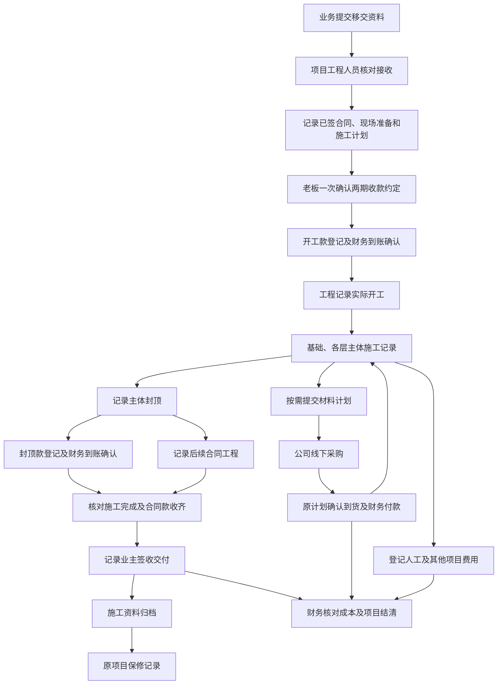

# 工程模块全业务主链路

2026年10月23日补充：材料计划支持有原因的改量、取消与恢复，不能少于已到货数量，已有付款不得由工程改量；到货、普通现场及节点完成记录可沿原单更正并保留历史。最近完成节点仅在后续无业务事实、无相关封顶款且尚未交付时可撤回，原待办随之恢复。工程负责人查看团队项目时不代建或改写下属新流程。

财务执行口径已于10月22日调整为只登记实际收付款：工程款由门店财务登记，成本核对与最终财务结清线下办理，归档页保留项目款项与成本回查并移除关闭动作。下文旧图中的“财务结清”表示线下收尾目标，不代表当前提供线上结清按钮；工程资料归档继续独立完成。本轮六角色主链和重要分支见 [全流程验收清单](六角色全流程验收清单_20261023.md)。

2026年10月21日。已按三批完成新业务工程的主链改造。每个项目由一名工程人员日常办理；工程只记录实际发生情况。工期、经办人和现场问题回到原项目或原事项继续记录。实际收付款沿用公司现有财务权限。

## 全业务主链

材料付款和到货分别按实际发生时间办理，可先款后货，也可先货后款。材料全部合格到齐后，当前施工节点可以完成；尚待财务办理的付款继续在原计划跟进。

## 每一步怎样接续

| 环节 | 工程侧记录 | 接续结果 |
| --- | --- | --- |
| 业务移交接收 | 原移交页核对图纸、版本、审核依据、客户确认和交底资料，选定工程人员本人接收 | 业务移交完成，工程自动建立同一项目的开工准备待办 |
| 开工准备 | 已签建造合同、合同总额、开工款、现场及班组情况、施工计划 | 封顶款自动为剩余合同金额；老板一次确认两期约定后生成开工款待办 |
| 开工款 | 实际收款金额、日期、流水及凭据 | 财务核实累计到账；足额且准备齐备后开放实际开工 |
| 实际开工 | 日期、现场情况和凭据 | 自动沿用项目工程人员，进入第一个施工节点 |
| 施工节点 | 先保存现场情况，实际完成后记录验收情况及凭据 | 核对本节点合格材料，完成后接续下一节点；无需新增材料的节点直接确认现场材料已核对 |
| 材料计划 | 材料名称、规格、数量、单位及需到场日期，项目和使用节点自动带入 | 提交后公司可采购；原计划同时跟进到货和付款 |
| 主体封顶 | 完成指定封顶节点，记录日期和现场凭据 | 自动生成第二期封顶款待办，后续施工继续记录 |
| 封顶款 | 沿原项目登记本期收款凭据 | 财务核实后回显本期已收和待收，合同两期收齐后可交付 |
| 其他费用 | 人工、运输等实际事项、金额、收款方和凭据 | 使用原费用与财务入口，实际付款计入同一项目成本 |
| 工程交付 | 核对全部节点及材料，留存业主签收人、日期和交付凭据 | 合同款足额后保存交付，生成施工资料归档待办 |
| 归档与保修 | 原项目确认归档；后续保修登记问题、处理情况和完成状态 | 施工资料归档，款项与保修仍沿原项目继续 |
| 财务结清 | 工程查看财务进度，财务核对实际收付、应付、成本及往来 | 原财务权限确认结清，不与施工归档混为一个状态 |

## 每个节点的四类记录

进入基础、各层主体、主体封顶或后续合同节点，就能查看施工记录、验收记录、材料计划、资金计划。项目层汇总进度及收付款，具体记录保留原节点关联。

施工情况可以先保存，完成时在同一节点记录验收。材料从节点提交后自动带入所属节点，到货、付款回到原计划。人工及其他费用从节点资金计划进入，自动带入原节点。资金计划只记录预计用款和用途，汇总本节点材料、费用及实付，不产生重复应付或实际付款，也不增加审批链。

工期和工程人员在原项目直接调整。人员变动后，新经办人用工程身份进入原项目继续，保留历次经办记录。最终原生主链、字体样式和换人接续的结果见[前端交付验收](../qa/engineering-native-20261021/前端交付验收.md)。

## 两次工程收款

开工款和封顶款合计等于已签合同总额，比例按项目约定。工程登记凭据后显示待财务核实；财务实际确认后才计入已收。每期可分笔累计，原期次显示应收、已确认、待确认和待收金额。

设计服务费使用原业务财务链路。材料及其他费用属于项目支出，客户工程款属于项目收入，分别保留原来源。

## 材料只保留三类操作

按[材料计划精简流程](材料计划精简流程_20261021.md)办理：工程提交计划，公司线下采购，工程确认实际合格到货，财务在原计划记录采购金额并办理付款。每份计划支持多种材料、分批到货和分笔付款。

不要求工程先填供应商和价格；付款前由公司或财务补齐实际供应方、单价、运费及采购凭据。系统自动维护原材料、供应和财务来源关联，页面直接围绕同一计划办理。到货记录保留本次数量、日期和凭据。

## 问题回原事项继续

- 工期或工程人员变化：在“项目记录与计划”直接调整，保留原经办及计划历史，业务与工程的当前工程人员同步。
- 现场有问题：先保存原节点现场记录，处理好后仍在原节点记录实际完成。
- 材料尚未到齐：原计划继续登记后续合格到货，累计显示实收和未到数量。
- 收付款资料需补充：从原收款或付款事项补证，保留已确认的实际资金记录。
- 交付后有保修：原项目补充处理记录，完成后更新原记录状态。

新工程不另设工期变更、人员交接、质量异常或整改复验审批链。工程首页分“待我办理”和“办理中”，已交财务的事项显示等待状态，仍能查看原事项。

## 三批改造与验证

第一批统一单人权限、业务资料和两期收款；第二批接入工程四个导航、项目记录、材料、节点和收尾页面；第三批连续办理同一项目，覆盖业务接收至财务结清。

实际完成范围、连续页面事件记录及原生验证边界见[工程改造验收](../qa/engineering-records-20261021/验收说明.md)。新业务工程使用简化记录流程，历史工程保留原有记录和办理入口。
