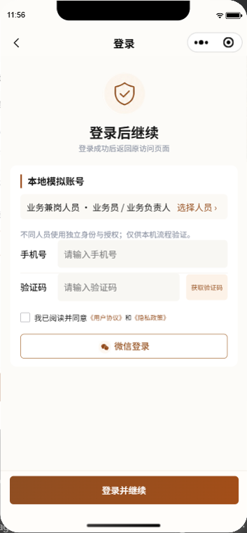

# 测试账号列表精简验收

- 按确认范围，业务、工程、财务各只显示一个兼岗测试人员：业务兼岗人员（sales-dual）、工程兼岗人员（engineering-dual）、门店财务兼岗人员（finance-dual）。
- 登录页默认选择业务兼岗人员，标签显示兼任的两个岗位。
- 其他同类账号仅从登录选择中隐藏，内部历史数据、岗位配置和流程回归用的测试身份继续保留。
- 老板和总部设计审批账号按原有有效岗位规则显示，金额审批及设计专业审核入口保留。

## 验证

- 登录 Page/WXML 与模型检查 6 项通过；排除并行改动的独立源码副本中同样通过。
- 微信模拟器检查 4 项通过，截取 7 张实际页面：列表精简、三个兼岗账号登录与两种岗位切换。
- 原模拟器数据恢复校验通过；业务获客到工程交付 12 步模型回归通过。

