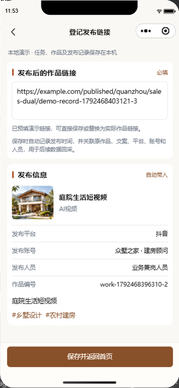
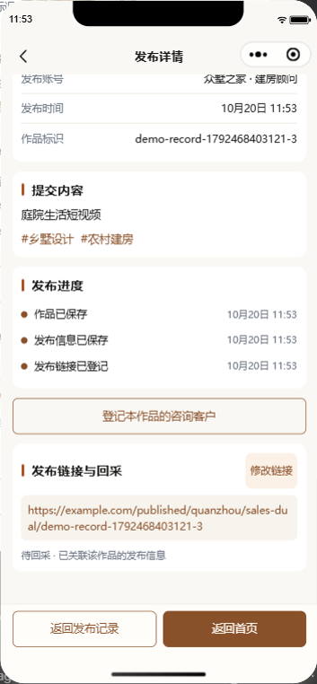

# 发布链接预填与首页返回验收

- 测试账号打开登记页后自动回填每条记录独立的演示链接；兼容历史空草稿，保留非空手工草稿与已存链接。
- 底部按钮为“保存并返回首页”，成功登记后重新打开业务首页并清理页面栈；校验失败保留输入，返回失败可重试且不重复登记。
- 已发布详情底部主按钮改为“返回首页”；“修改链接”放在链接卡片标题右侧，发布记录与咨询登记入口保留。
- 保留原有作品、账号、平台、人员、发布时间和来源追溯；演示链接保存后为待回采，不伪造指标。
- 为避免本次新增逻辑突破原有主包上限，创作详情页面采用独立分包，路由不变。

## 验证

- Page/WXML 专项 11 项、发布校验 8 项、创作到咨询转客户 7 项全部通过。
- 业务员与负责人原生模拟器检查 6 项通过，截取 6 张实际页面；模拟器原数据恢复校验通过。
- 排除并行任务未提交改动的独立源码副本中，专项 11 项和静态检查通过，主包 2,024,187 字节（含账号精简变更）。

## 实际页面

