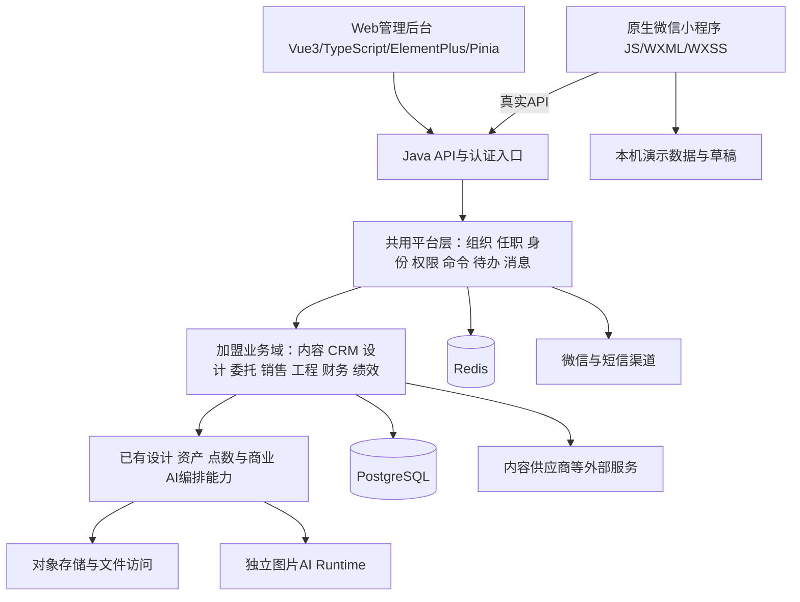
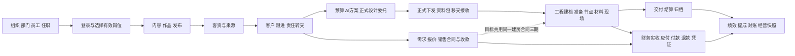

# 众墅平台全业务审查：架构、联动关系与整改总览

**最终业务规则入口：**[业务规则与角色职责](/Users/honor.pei/Documents/企业FDE项目/众墅之家AI赋能平台/平台程序/docs/business-flow-audit-20261103/16-业务规则与角色职责-最终版.md)。规则按业务角色、说明和最终决策记录；本总览中的源码状态属于整改前基线，不能替代最终业务规则。

审查日期：2026-11-03。范围：原生小程序、管理后台、Java后端，以及它们共同支撑的员工业务链。

本批产物为代码审查、整改任务书和独立文档评审记录。业务代码修复、数据库迁移、真实供应商调用、微信上传和生产部署均不在本批执行记录中；任务清单中的“待实施”保持未完成。

## 1. 整体判断

项目已经具备多模块后端、原生小程序及Web管理底座。组织任职、CRM、设计赋能、销售、财务、工程、绩效等真实API有实现，不能概括成“只有原型”。当前主要问题集中在业务交接没有完全连通、部分页面仍以本地数据为真、认证生命周期不一致、文件与记账契约存在明确错误，以及验证脚本不足以证明完整流程。

这意味着单个服务有接口、某项专项脚本通过，并不能推出员工从开通到项目归档已经可以连续办理。判断完整交付，必须用同一组织、同一客户、同一项目，由不同真实岗位接续，并反查每笔状态、金额和文件来源。

文档覆盖12个模块、51条原始基线观察和4条最终规则适配记录，共55条记录、67项整改或验证任务。基线观察包含共享根因、条件风险和原交付边界；新增4条记录用于三期合同、劳务支出、线下退款及绩效适配，不属于新增漏洞。规则已定稿，代码整改与真实验收仍待完成。

## 2. 两个文件夹是什么关系

| 目录 | 实际内容 | 当前身份 | 与另一目录的关系 |
|---|---|---|---|
| [zhongshu-ai-platform-v3](/Users/honor.pei/Documents/企业FDE项目/zhongshu-ai-platform-v3) | 原生小程序、演示模型、真实API封装及校验脚本 | `feat/performance-api-integration-20261103`，`f2592ce` | 通过HTTP访问后端；不是Java项目的源码子目录 |
| [众墅之家AI赋能平台](/Users/honor.pei/Documents/企业FDE项目/众墅之家AI赋能平台) | 独立后端仓库根；实际项目在`平台程序` | `feat/backend-miniapp-parity`，`88cd000` | 包含Java服务和`平台程序/admin-ui`，向小程序与Web提供API |

两个根都有独立Git历史，却配置了同一个origin。它们是同一业务系统的两份独立工作区，不能因为remote相同就当成同一提交线，更不能直接合并不相关历史。本轮没有fetch、改remote或合并分支；远端实时引用未核验。

后端外层“后端程序”目录不能替代“平台程序”判断实现位置。运行和构建以实际源码、pom与部署配置为准。发布时应分别记录小程序提交、Web/Java提交、AI Runtime产物版本，而不是只报一个“项目版本”。

## 3. 当前技术架构

- 小程序是原生工程，并非Web后台的移动适配版。部分页面已走真实API，部分仍保留经明确区分的本地演示路径。
- 后端采用Java17、Spring Boot 3.5.15与Maven模块化单体，最终由`yudao-server`装配成服务；`platform`与`domains/franchise`是代码边界，不能据目录数量推断为多个已部署微服务。
- Web后台采用Vue3、TypeScript、Element Plus、Pinia、Vite。系统用户、角色、部门和原设计运营界面存在，但新加盟业务域并未全部有Web操作页面。
- PostgreSQL与Redis是后端依赖。初始化还涉及底座数据与Flyway迁移；源码能编译不等于空环境可启动。
- 员工侧设计通过加盟域边界复用已有设计、资产、点数能力。图片AI Runtime另有进程边界，当前两目录中未找到完整Runtime源码；需明确交付来源，不能断言线上不存在。
- 生产/开发通道必须分开验收。开发字节上传、假供应商与种子数据不是正式COS、真实供应商和真实角色的证据。

架构源码与部署证据详见[M12](/Users/honor.pei/Documents/企业FDE项目/众墅之家AI赋能平台/平台程序/docs/business-flow-audit-20261103/M12.md)，文件和跨域公共契约详见[M11](/Users/honor.pei/Documents/企业FDE项目/众墅之家AI赋能平台/平台程序/docs/business-flow-audit-20261103/M11.md)。

## 4. 业务主线与关联对象

销售“四节点交付登记”与工程交付不是同一状态机；设计委托下发和工程资料包接收也有独立权限与状态。审查发现的断点必须在这些真实边界上解决，不能把某个“交付完成”字段自动当成所有模块均完成。

| 关联线 | 应持续核对的对象 | 关键问题 |
|---|---|---|
| 身份与范围 | userId、orgId、postId、teamId | 当前请求岗位、页面状态、后台任职必须一致 |
| 内容到客户 | taskId、workId、publicationId、leadId、customerId | 来源不能在登记时丢成直接来访，待关联线索必须可处理 |
| 客户到设计 | customerId、designProjectId、scheme kind/version、commissionId | AI成果与正式委托不是同一步；方案及预算版本要可追溯 |
| 交易到工程 | saleContractId、commissionId、packet、engineering projectId | 同一建房合同三期共用；总部设计委托和材料劳务支出独立关联 |
| 工程到财务 | projectId、sourceType/sourceRef、receiptId/payableId/paymentId/refundId | 幂等、退款净额、发生日期、ID精度与项目归属一致 |
| 文件到业务 | assetId、assetType、sha256、uploadStatus | 只有票据不等于有字节；有ID不等于业务可引用 |
| 财务到绩效 | 业务发生日期、period、snapshot version | 空日期不能漏计；历史月不能混入当前余额却标月末截面 |
| 离职与逆向操作 | 原经办人、当前责任人、版本及更正链 | 撤权要及时，业务交接和历史审计要保留 |

## 5. 模块报告入口

| 顺序 | 模块 | 观察/任务数 | 关键结论 |
|---|---|---|---|
| 01 | [组织与员工开通](/Users/honor.pei/Documents/企业FDE项目/众墅之家AI赋能平台/平台程序/docs/business-flow-audit-20261103/M01.md) | 6 / 6 | 删除撤权、冲突部门及交接整改；本组织任职与全局停用边界已定 |
| 02 | [登录与岗位切换](/Users/honor.pei/Documents/企业FDE项目/众墅之家AI赋能平台/平台程序/docs/business-flow-audit-20261103/M02.md) | 5 / 5 | body401未清会话、新token搭旧岗位、退出范围不一致、生产短信装配 |
| 03 | [内容创作与获客](/Users/honor.pei/Documents/企业FDE项目/众墅之家AI赋能平台/平台程序/docs/business-flow-audit-20261103/M03.md) | 4 / 5 | 页面路径、增长返回形状、来源丢失与真实线索读回 |
| 04 | [客户、跟进与转交](/Users/honor.pei/Documents/企业FDE项目/众墅之家AI赋能平台/平台程序/docs/business-flow-audit-20261103/M04.md) | 4 / 5 | 分页截断、转交候选丢失、同名映射、待关联处置入口 |
| 05 | [设计赋能与正式委托](/Users/honor.pei/Documents/企业FDE项目/众墅之家AI赋能平台/平台程序/docs/business-flow-audit-20261103/M05.md) | 4 / 5 | 正式委托UI未接通、筛选请求代次、选客户仅首50条 |
| 06 | [报价、合同与移交](/Users/honor.pei/Documents/企业FDE项目/众墅之家AI赋能平台/平台程序/docs/business-flow-audit-20261103/M06.md) | 3 / 5 | 工程接续与三期统一建房合同整改；401状态风险保留验证 |
| 07 | [工程执行与材料劳务](/Users/honor.pei/Documents/企业FDE项目/众墅之家AI赋能平台/平台程序/docs/business-flow-audit-20261103/M07.md) | 6 / 7 | 材料幂等与资产引用修复、三期合同适配、劳务支出、真实凭据正式交付 |
| 08 | [财务与凭证](/Users/honor.pei/Documents/企业FDE项目/众墅之家AI赋能平台/平台程序/docs/business-flow-audit-20261103/M08.md) | 7 / 8 | 到账异常、上传摘要、旧岗覆盖、日期和ID修复，以及线下退款三方向登记 |
| 09 | [交付、结算与归档](/Users/honor.pei/Documents/企业FDE项目/众墅之家AI赋能平台/平台程序/docs/business-flow-audit-20261103/M09.md) | 4 / 5 | 证据引用整改、净实收门禁、直接项目费用及归档后财务修订 |
| 10 | [绩效、提成与经营](/Users/honor.pei/Documents/企业FDE项目/众墅之家AI赋能平台/平台程序/docs/business-flow-audit-20261103/M10.md) | 6 / 7 | 经营真源与历史快照整改、退款提成核对、三期来源适配且不自动增加发放次数 |
| 11 | [消息、文件与公共能力](/Users/honor.pei/Documents/企业FDE项目/众墅之家AI赋能平台/平台程序/docs/business-flow-audit-20261103/M11.md) | 3 / 4 | 五页引用故障、消息旧响应、文件通道跨域验收 |
| 12 | [Web后台、部署与验证](/Users/honor.pei/Documents/企业FDE项目/众墅之家AI赋能平台/平台程序/docs/business-flow-audit-20261103/M12.md) | 3 / 5 | 标识脚本假通过、底座岗位不等于业务任职、双仓与Runtime交付追溯 |

每篇均包含实际流程、权限与已有保护、上下游/逆向联动、问题证据、整改任务、负向与连续验收。审查覆盖关键业务路径和入口，不宣称每个文件已逐行证明正确；未运行的分支继续保留验证任务。

## 6. 优先整改方向

1. 恢复验证可信度与页面可运行性：先让坏样本正确失败，再修五页路径，之后联合转绿。
2. 收拢身份生命周期：删除、撤岗、停用、登录换号、退出与旧请求隔离分别核对，防止页面和服务端身份不一致。
3. 修复财务基础契约：稳定幂等键、准确单据ID、原始字节摘要、业务日期及当前岗位数据隔离，先于扩展业务接入。
4. 连通获客、客户、设计委托、资料移交和工程主线，按真实交接对象验收。
5. 按最终退款登记、直接费用、绩效和月末快照规则实施，再完成同客同项目联合验收和正式环境验证。

详细顺序、公共修复归口及全部任务见[13-整改任务总表](/Users/honor.pei/Documents/企业FDE项目/众墅之家AI赋能平台/平台程序/docs/business-flow-audit-20261103/13-整改任务总表.md)。独立评审意见见[14-文档评审记录](/Users/honor.pei/Documents/企业FDE项目/众墅之家AI赋能平台/平台程序/docs/business-flow-audit-20261103/14-文档评审记录.md)，复现记录见[15-证据与验证边界](/Users/honor.pei/Documents/企业FDE项目/众墅之家AI赋能平台/平台程序/docs/business-flow-audit-20261103/15-证据与验证边界.md)。

## 7. 最终业务规则

完整说明、角色职责和最终决策见[业务规则与角色职责](/Users/honor.pei/Documents/企业FDE项目/众墅之家AI赋能平台/平台程序/docs/business-flow-audit-20261103/16-业务规则与角色职责-最终版.md)。

| 规则 | 最终决策 | 主要业务角色 |
|---|---|---|
| R01 任职与离职 | 组织仅管理本组织任职；平台管理员管理全局账号；离职生效即撤权，紧急立即撤权，未交接事项转负责人，历史经办保留 | 平台管理员、组织管理员、接收人 |
| R02 组织开通 | Web正式开通并指定首任管理员；管理员建部门、员工、岗位；开通、授权、充值独立 | 平台运营、组织管理员 |
| R03 三期合同及收支 | 甲方建房款按签订后、基础完成后、封顶后三期，每期可分笔；同一合同和资金事实供销售工程财务共用；加盟商设计委托、材料及劳务为对外支出 | 业务、工程、两侧财务、甲方、供应商与劳务方 |
| R03 移交版本 | 使用最新正式确认且已下发版本，移交包固定版本并在接收时冻结，后续变更留版本 | 总部设计、业务、工程接收人 |
| R04 日期 | 正常归单归月日期必填，前端默认可改；日期待核的真实异常单列，历史补正保留依据和报告版本 | 经办人、财务、报表修订岗位 |
| R05 退款登记 | 线下执行、财务登记核对；退款按原单方向反映净实收或已付现金；合同和费用金额须独立确认变更；异常资金可留痕，历史工程不倒退，提成不自动扣回 | 业务、工程、财务、老板 |
| R06 报表与费用 | 实时与月末报表分开，修订保留版本；直接项目费用纳入，成本/应付/付款不重复，公共费用本期不自动分摊 | 财务、工程、老板 |
| R07 正式交付 | 本期完成真实短信与工程凭据；基础、核心业务及AI能力分别取得真实验收证据 | 平台运营、实际业务岗位 |

三期金额以具体合同为准，不预设固定比例；设计委托收费阶段不受建房三期覆盖。业务规则已定稿不表示源码已适配，整改完成以逐项验收证据为准。
